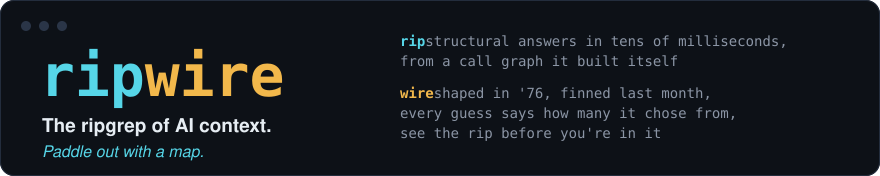
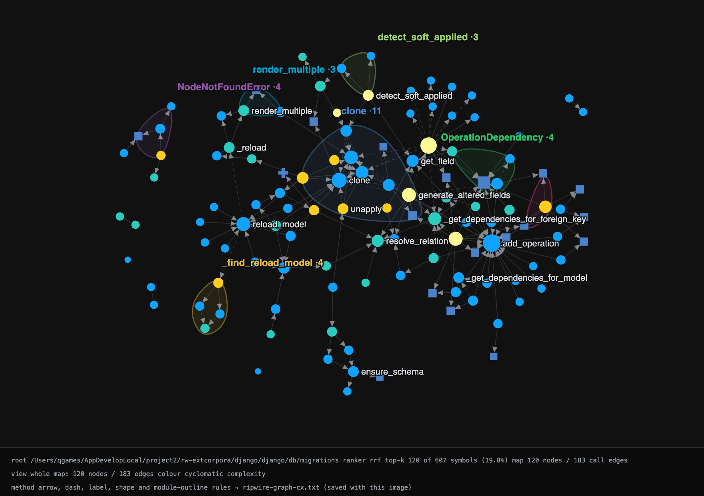
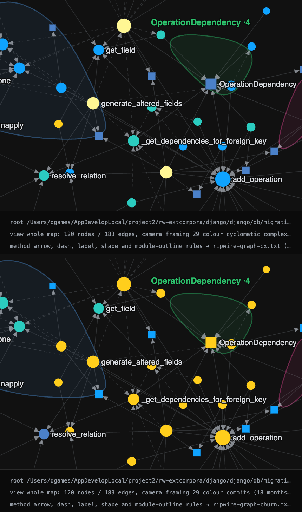
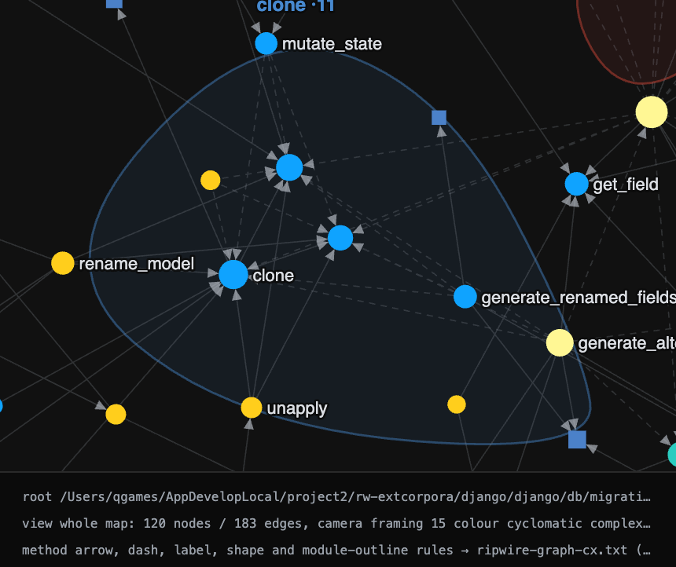
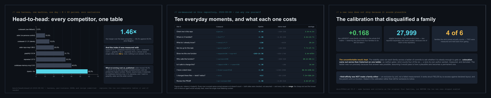

[](https://github.com/redhat-et/ripwire/actions/workflows/ci.yml)
[](https://github.com/redhat-et/ripwire/releases/latest)
[](LICENSE)
[](CONTRIBUTING.md)
[](THIRD_PARTY.md)
[](present/ripwire-showcase.pdf)

<p align="center"></p>

# Rip'n Fast. Fewer Tokens. Better Code.

**The ripgrep of AI context. A map before your agent reads the repo — and a check on what it writes.**

<p align="center"><a href="https://trendshift.io/repositories/217924?utm_source=trendshift-badge&amp;utm_medium=badge&amp;utm_campaign=badge-trendshift-217924"></a></p>

Ranked, deterministic call graph: what to touch, what it breaks, which tests to run. On the edit: blast
radius, tests that reach it, thirteen quality kinds reporting only what got worse, forgotten co-changes, fields
read and written, names that resolve more than one way.

**Just want to use it?** Install it with the one line below, then start each coding session by telling your agent to
use it, for example: *"Use ripwire on this repo."* That is all most people need: the install also teaches your agent
when to reach for each command.

**Want every detail?** [The reference guide](docs/REFERENCE_GUIDE.md) covers install, commands, output
format, exit codes and limits. You do not need it to get started.

**Field report: what ripwire contributed to a large multi-agent coding engagement** — written by Claude Fable 5.0, the frontier model orchestrating ~20 coding agents over two days on a ~1,500-file C++/Metal codebase. Its bottom line: a good lookup accelerator for one developer, and load-bearing for an orchestrated fleet. It halved the research spend, redirected two tasks before work was wasted, caught at least one bug before it shipped, and made code-quality checks a per-task gate: about 2× on the whole workflow, 10–25× per lookup.

<details>
<summary>The full report (image and a text version)</summary>

<p align="center"><a href="docs/assets/field-report-multi-agent.jpg"></a></p>

<details>
<summary>Text version of the report</summary>

**Field report: what ripwire contributed to a large multi-agent coding engagement**

*Context, genericized: one orchestrating session directing ~20 sequential/parallel coding agents over a ~1,500-file
C++/Metal codebase across two days — a deep architecture audit, then a 14-task feature wave (new subsystems,
measurement infrastructure, a search-archive migration), ending in a verified all-on release flip. Every agent was
instructed to lead with ripwire for orientation and to close with its quality gates.*

**The headline numbers**

- **Roughly half the total token spend of the audit/research phase, saved.** This is the operator's whole-phase
  estimate — it includes everything the research agents did, ordinary file reads and all, which makes it conservative
  rather than cherry-picked. The per-call factors underneath are much steeper: a single doc-recall call served the
  relevant sections of a 164KB planning document in ~6K tokens (~25×), and agents that led with the tool ran ~30–40%
  leaner on tool-call counts than agents doing raw read fan-outs over comparable questions.
- **Two tasks had their direction changed by a single call.** One task was chartered to activate a steering behavior
  the team believed was in production; one `--callers` query returned **zero production callers**, redirecting the
  task to the real gap (the data provider that behavior needed had never been wired anywhere). Another task
  refactored a widely-shared computation; `--edit-check` flagged **5 of 6 call sites** as incompatible — sites a text
  search had missed — that would otherwise have silently diverged from the canonical path the day the feature was
  enabled, surfacing months later as an unexplainable visual bug.
- **A dozen-plus real code-quality defects fixed, not waived, across ~15 implementing agents** — all caught by
  `--quality-delta` at each agent's "I think I'm done" moment: a 480-token duplicated routine, a fourth private copy of
  a shared RNG utility, a hand-duplicated cost function, a pair of near-identical functions with a flipped sign
  (correct at one boundary, quietly wrong at the other), test-fixture duplication across sibling suites, and functions
  that had quietly absorbed a second job. None of these would have failed a test; all of them are the sediment that
  rots a codebase under high-velocity multi-agent development. The gate made removing them routine instead of heroic.

**Where the value concentrated**

1. **Orientation and recall (the token win).** Ranked-signature task orientation and section-granular document recall
   meant agents started from *answers*, not file dumps. Recall over planning docs was the orchestrator's single
   most-used verb — the audit's entire framing came from two calls.
2. **The contract checker (the shipped-bug preventions).** Beyond the 5-of-6 catch above, `--edit-check` gave
   near-free proof-of-contract on every public-symbol change across the wave — the kind of verification that
   otherwise simply doesn't happen at agent speed.
3. **The quality gate as a *protocol*.** The measurable effect wasn't any single catch — it was that fifteen different
   agents, none sharing context, all converged on the same "fix or justify with a written reason" discipline, with an
   acknowledgments ledger that survived across tasks. Unattended orchestration usually leaks quality; here the
   leak-check was mechanized.
4. **Persistent notes.** Agents left gotcha notes pinned to symbols mid-wave (a caller-wiring law, an arming-rule
   invariant), which later agents' lookups surfaced automatically — cheap institutional memory between contexts
   that never met.

**The honest boundary**

- **The engagement's deepest findings did not come from the tool.** A structural capacity ceiling, a mis-derived
  constant, a floating-point re-association drift of 1 ulp, and a seed-keying bug were all found by *bespoke
  measurement the agents built* — baseline worktree diffs over full data fills, multi-arm attribution sweeps,
  funnels. The tool is a floor for honesty and orientation, not a substitute for measurement design.
- **Known false-positive mode, handled by its own documentation:** the contract checker's arity heuristic
  over-counts on defaulted trailing parameters (one task saw "incompatible=18" that were all fine). The tool's own
  trust-calibration notes say to verify by compiling in exactly this case, and agents that followed them lost nothing.
- For broad, common-word conceptual queries, plain grep-and-read still occasionally won — consistent with the tool's
  own guidance that it shines on specific technical asks.

**Bottom line**

For a single developer, this tool is a good lookup accelerator. For an *orchestrated fleet*, it's load-bearing: it
halved the research spend, twice redirected tasks before wasted work, prevented at least one silent-divergence shipped
bug, and turned code-quality hygiene from a hope into a per-task mechanical gate. Whole-workflow ~2×; per-lookup
10–25×; and two moments where one call was worth more than the rest of the session's tooling combined.

</details>

*The model's own report of one engagement, on a version before 0.5; not a controlled measurement. Controlled
measurements are in [docs/EVALS.md](docs/EVALS.md).*

</details>

<details>
<summary><b>Fifty years of software-engineering results, and research from last month.</b> 49 repositories and 79 papers folded — McCabe (1976) through to <b>seven published in the last two months</b> — each row in <a href="docs/LINEAGE.md"><b>docs/LINEAGE.md</b></a> naming the lesson taken and the file it lives in</summary>

Beside those sits a labelled survey of **237 tools** that contributed nothing and says so. The two
sets are disjoint by construction, so they add rather than nest — a tool that gave a lesson is never
counted twice.

**Both halves are load-bearing, and they are doing different jobs.** The settled results are what
make the quality lens trustworthy: McCabe on complexity (1976), Halstead on volume (1977), Spärck
Jones on term specificity (1972), Nagappan & Ball on churn. Fifty years of replication means those
are not opinions, and a tool that measures your code should be built on the ones that survived.

The recent work is what makes it *current*: **seventeen of the folded papers are from 2026, seven
published in the last two months and three in the last thirty days** (dates as of 2026-09-08; every
row carries its arXiv id, so the claim is checkable rather than atmospheric). Retrieval for coding
agents, context-compression cost, placebo-controlled localization — that literature is months old,
not decades, and several rows were folded within weeks of the paper appearing.

Neither half alone would be enough. A tool built only on the classics would not know what an agent
needs; one built only on last month's preprints would have nothing underneath it. And the newest row
is a result that **failed** when it was tested here — which is the point of writing them down. All three counts are re-derived from that document's own tables by
`test/readmedriftcheck.sh` on every run, which fails if this page and those tables disagree, so the
claim cannot quietly drift. The row-by-row ledger is
[`docs/LINEAGE.md`](docs/LINEAGE.md).
</details>

**Languages:** Rust · C++ · Objective-C/C++ · C · Metal · CUDA · Python · Go · Swift · TypeScript ·
JavaScript · Java · Ruby · PHP · Lua · Elixir · Dart · Kotlin · GDScript · Clojure · Bash · C# · Protocol Buffers · JSON · TOML · YAML · Markdown — see
[language support and limits](#languages).

**Latest: 0.7.0** — practical for large repositories on small and normal-sized machines: llvm-project (80,576 source files of the 180,650 git tracks) indexes cold in 28 s at a 5.1 GB peak; complete answers on 126 of 213 held-out tasks, against 68 for the next tool. [Release notes](#release-notes) ·
[the presentation](present/ripwire-showcase.pdf) · [the changelog](CHANGELOG.md) — with thanks to the
contributors named there.

---

<p align="center"></p>

<details>
<summary><b>One process, no server</b> — indexes this repository in <b>0.25 s</b> using <b>6.6 MB</b>, against <b>46.8 s</b> and <b>391 MB</b> for the graph-database MCP server it was measured against; warm queries answer in <b>197 ms</b> to its <b>1,082 ms</b></summary>

Measured on 48 matched questions across django, webpack and this repository. Across all three,
ripwire indexes in **0.25–0.45 s** and **6.6–16.5 MB** against that server's **23–52 s** and
**391–623 MB**. The full method, the wins named one by one and the losses included, is in
[Against the leading graph-database code-context MCP server](#against-the-leading-graph-database-code-context-mcp-server)
and [`docs/EVALS.md`](docs/EVALS.md).
</details>

<details>
<summary>One binary, offline — and the same line <b>activates the skills</b> for every agent it finds: Claude Code · Codex · Cursor · Windsurf · Gemini · opencode · aider</summary>

One self-contained binary on your own machine, offline, installed in one line — and the same line
installs *and activates* the task-shaped skills that teach your agent *when* to reach for it, not
just how, for every agent it finds on the machine. If your
agent can run shell commands — Claude Code, Codex, Cursor, Windsurf, Gemini, opencode, aider — it is
set up the moment the install finishes; [the MCP server is the optional second
interface](#set-it-up-in-your-coding-agent). Install it and ask it something before you finish
reading this page:
</details>

```bash
RIPWIRE_REPO=redhat-et/ripwire bash -c "$(curl -fsSL https://raw.githubusercontent.com/redhat-et/ripwire/main/scripts/install.sh)"
export PATH="$HOME/.local/bin:$PATH"      # where it installed; the installer prints this line if you need it
cd your-repo
ripwire . --for="<the change you are about to make, in words>"
```

Every install route (prebuilt, from source, per-agent skills, hooks, the MCP server) is in [INSTALL.md](INSTALL.md).

**Reach for the CLI first — it is the cheaper interface.** The MCP server is the optional second
way in, and its convenience has a cost the shell pipe does not carry: its verb schemas sit in your
agent's context every session, whether or not it calls them.

### How ripwire compares

Six tools on one machine (Apple M5 Pro, 18 cores, 48 GB), one tool at a time, default settings, measured 2026-11-22:
ripwire 0.7.0, codegraph 1.6.2, cbm 0.12.1, graphify 0.9.108, graft 0.29.0, crg 2.4.0. **Bold** = the best value in a
row. How each number was measured: [docs/EVALS.md §2b](docs/EVALS.md#2b-the-070-comparison-tables-measured-2026-11-22).

#### Speed

| Wall clock | ripwire | codegraph | cbm | graphify | graft | crg |
| --- | ---: | ---: | ---: | ---: | ---: | ---: |
| Cold index, envoy | **2.3 s** | 37.6 s | 14.6 s | 102.8 s | 22.8 s | 58.6 s |
| Cold index, vscode | **5.1 s** | 173.9 s | 61.1 s | 257.5 s | 54.6 s | 184.5 s |
| Cold index, llvm-project (limit 1 h) | **28 s** | 509 s | 291 s | stopped at 1 h | failed | stopped at 1 h |
| First answer from nothing, envoy | **3.0 s** | 38.5 s | 15.3 s | 108.8 s | 24.7 s | 58.9 s |
| First answer from nothing, vscode | **6.2 s** | 176.3 s | 61.8 s | 267.7 s | 59.5 s | 184.8 s |

<sub>Cold = index from nothing. "First answer from nothing" = the cold index plus one question asked through each tool's documented
query entry (ripwire `--for`), the sum of the two medians: what an agent waits for at the start of a session. ripwire: median of 5 runs;
others: median of 3; all on 2026-11-22 on a quiet machine. llvm-project: one run per tool, each alone, limit 1 hour and
36 GB; "stopped at 1 h" is our limit, not the tool failing (crg had parsed 16,600 of 77,918 files; graphify had finished
parsing and was still building). graft failed: its parser aborted on 59,479 of 73,559 files and the process exited with
an error after 42 s, the same on a second attempt.</sub>

#### Memory

| Peak memory | ripwire | codegraph | cbm | graphify | graft | crg |
| --- | ---: | ---: | ---: | ---: | ---: | ---: |
| Indexing envoy | **0.7 GB** | 5.3 GB | 2.0 GB | 3.4 GB | 3.4 GB | 2.1 GB |
| Indexing vscode | **1.1 GB** | 12.0 GB | 4.5 GB | 4.0 GB | 5.5 GB | 3.2 GB |
| Indexing llvm-project (limit 36 GB) | **5.1 GB** | 16.1 GB ▲ | 19.2 GB ▲ | 9.5 GB at the stop | 5.9 GB at the failure | 5.5 GB at the stop |
| Index on disk, vscode | **0.3 GB** | 2.0 GB | 1.6 GB | 0.6 GB | 1.3 GB | 5.5 GB |

<sub>▲ = more than a 16 GB machine has. Peak resident memory over the whole process tree, background daemon included; GB = 2³⁰ bytes. llvm-project: ripwire's
figure is the larger of its cold index (3.7 GB) and its first question; ripwire indexes 80,576 of the 180,650 files git
tracks. codegraph sizes itself to the machine, so its figures are what it took with 48 GB available. Its llvm-project peak is not much above its vscode peak because, measured per file indexed, vscode cost it about 3.5 times as much: 16,305 files at 12.0 GB on vscode (almost all TypeScript), 76,181 files at 16.1 GB on llvm-project (mostly C and C++); its vscode figure repeats within 7% over three runs (11.9 to 12.6 GB).</sub>

#### Answers

| One call per task · 213 held-out tasks | ripwire | codegraph | cbm | graphify | graft | crg |
| --- | ---: | ---: | ---: | ---: | ---: | ---: |
| Complete | **126** | 68 | 66 | 55 | 34 | 53 |
| Partial | 83 | 98 | 117 | 123 | 137 | 114 |
| Missed | **4** | 47 | 30 | 35 | 42 | 46 |
| Complete, of the 135 tasks that touch two or more files | **57** | 16 | 14 | 12 | 4 | 5 |
| Failed calls | 0 | 0 | 0 | 0 | 0 | 0 |
| Says when the answer was cut | **209** | 197 | 207 | 163 | 0 | 193 |
| Gives the next call to continue, of those cut | **209 of 209** | 0 of 197 | 206 of 207 | **163 of 163** | — | 0 of 193 |

**What the tasks are.** Each task is a real commit from an open-source project. The question is that commit's message,
and the tool answers from the code as it was *before* the commit. The right answer is what the commit actually changed:
every file it edited and every function it modified. 135 of the 213 touch two or more files, half of those three or
more, and 97 of those 135 name none of the functions they change.

**Where they come from.** 37 repositories in 11 languages, none used while building or tuning any tool compared here:
Python (httpx, attrs, marshmallow, jinja) · JavaScript (prettier, Chart.js, undici, express) · TypeScript (excalidraw,
vitest, redux-toolkit, mobx) · Shell (sdkman-cli, LinuxGSM, bats-core, shellspec) · Rust (clap, starship, zellij) ·
Go (lazygit, hugo, urfave/cli) · Java (jsoup, commons-io, junit5) · C++ (aria2, CLI11, googletest) ·
C (libuv, zstd, nginx) · C# (FluentValidation, NLog, CsvHelper) · Ruby (puma, liquid, rubocop).

**What the questions look like** (from a separate development set built the same way, so the 213 stay unpublished):

- *Go, one file:* "prettify error message for catch-all conflict with existing path segment" (gin)
- *C++, two files:* "Add `SliderWithCallback` component. Add SliderOption::on_change. Useful to observe a change to the value." (FTXUI)
- *Rust, three files:* "Refactor: `merge_exit_codes` now takes an `impl IntoIterator<Item = ExitCode>`. This way, callers don't need to collect into a slice / vec." (fd)
- *Python, three files:* "Allow customization of help option right from its decorator. Removes `click.decorators.HelpOption` class." (click)

<sub>**Complete** = names every file the change touched and locates every function it changed; **partial** = some of
them; **missed** = none, or the call failed. One call per task, each tool's documented free-text entry, default
settings; graft ran without its `init` step. The same grader scored all six tools, its rules fixed before any tool ran on
these tasks; one task (of 214) was excluded beforehand because the grader could not score one tool's answer format on
it. "Says when cut" and "gives the next call" are read from each answer's own text under definitions written before any
count was taken; a pointer to run another tool without arguments does not count as a next call.</sub>

<sub>**Setup outside the repository** (from each tool's own documentation, not measured): ripwire reads and writes
nothing outside the repository. graphify reads the API keys in the environment to pick an LLM backend and writes
`~/.claude/CLAUDE.md`; graft's `init` reads your past coding-agent transcripts and, with `gh` signed in, your last 50
merged PR reviews (graft ran here without `init`), and it edited the tracked `.gitignore` (observed); codegraph writes
agent configuration for 9 agents, cbm for 45 agent surfaces; crg writes its own `.gitignore`.</sub>

### The goal: one question, one complete answer.

**Terminality is the objective.** Ask the codebase a question and the answer should carry everything
you need — no follow-on grep, no three more whole-file reads to fill in what it left out. A call
followed by three greps is the same search paid for twice: it does not save you tokens and it does
not make the coding faster.

**Two jobs, one goal.** An agent meeting a codebase does two things, and ripwire is shaped for both:

1. **Orient — `ripwire .`** One call gives the ranked map: the main subsystems, the program entry points,
   the symbols that matter most, and a count of every file the ranking left out. The most important
   information about a new tree, in as few calls as possible.
2. **Ask — `--for`, `--expand`, `--callers`, `--path`, …** After that, each question gets a lean answer:
   as few bytes as it can spend while still answering the question fully, so no follow-up grep is needed.

That is the goal, and not every answer reaches it yet; the stair-steps below are how we get there.

<details>
<summary>The two stair-steps that make it reachable — <b>honest about what is missing</b>, <b>priced in what it spends</b></summary>

**Two things make that reachable in practice, and neither is the destination.** Answers are honest
about their own limits — a count that cannot be a total is labelled a floor, a zero means "none
found" and never "none exists", every truncation is disclosed — so an answer never looks more
complete than it is, and the map never degrades the code by guessing. And an answer can be given a
token budget, so what one costs is something you ask for rather than discover; where a complete
answer will not fit, it says it went over rather than silently dropping the row you needed.

Those two are the stair-steps: honest about what is missing, priced in what it spends. The step they
climb toward is a question fully answered in one call, which is not always trivial to reach — and
where it is not, the output says so rather than pretending otherwise.

**How we measure the climb.** A complete answer to every code question is genuinely hard, and it is
reached over many releases rather than in one. Until an answer can be complete, it owes you three
things: it stays bounded in size, it is fully honest about what it does not know, and it gives you a
clue where to look next. So every change is judged on more than "was it right":

- **Complete answers:** the share of questions answered so you can act without re-checking.
- **Honest-partial rate:** how often an incomplete answer says what it is missing, instead of
  sounding confident.
- **False-confidence rate:** wrong answers that claim to be complete — the worst case, held near zero.
- **Next-clue usefulness:** for partial and wrong answers, whether following the answer's first
  suggested next step reaches what the question needed, within one hop. Graded blind.
- **Recoverability:** for every cut answer, whether following its `next=` returns everything that was cut.
- **Tokens per complete answer:** total tokens an agent spends across a scenario, divided by the questions it got fully answered.
- **Cut-row recoveries:** how often a needed item arrived only through a continuation.

**Answering comes first; efficiency is how we get there.** We aim for answers about as lean as the
leanest tools, but a byte budget is never allowed to cost an answer. We have gone too far toward short
answers before and cut information that was needed, so now every size limit has one of two jobs: a
runaway guard far above typical answers (it catches an output bug, and says so when it trips), or a
stair-step target where anything over it must be explained. A capped answer is always measured
against the same answer uncapped, and the one that answers better wins.

**A cut is only honest if you can get the rest back.** Disclosing a cut is the floor, not the bar: a capped
answer plus the `next=` it prints must return everything the uncapped answer had. A test that checks this for every
budget option on every command is being built, so that "the answer was cut" always comes with "and here is the rest".

**What a budget may spend first.** When a budget is tight, ripwire drops bytes that carry no answer before
it drops answers: repeated legend text, duplicated paths, bodies whose signature already says what you need.
Only then the lowest-ranked rows, each counted. A whole section never disappears without a marker.

**Budgets are yours to set, never ours to impose.** The defaults and the setups `ripwire wrap` writes carry no
budget that cuts a typical answer; a budget is a choice the caller makes, with its cost disclosed.

**Efficiency is counted per complete answer, across the whole task.** Bytes per answer can fall while the task
gets more expensive, if the agent then has to ask again. So the efficiency figure is tokens per complete answer
over a whole scenario — orient, then the questions that follow — not bytes per call.

**Ranking is the tool's best guess; the next= is the safety net — and we measure how often the net is needed.** ripwire cannot always
know which row answers the question; it goes by ranking. When a needed item appears only after following an answer's next=, the
honesty layer saved the answer but the ranking put that item below the cut. We count those per round:
- **Recovered through next=:** the item was cut but recoverable — one extra call. Driving this down is ranking work.
- **Lost:** the item was cut with no marker or no working next= — a bug, fixed first.
</details>

### Same answer, a fraction of the tokens — read this table first if your agent is on a budget

<details>
<summary>How these ten rows were measured — <b>2026-08-08</b>, figures in ~tokens (≈ bytes/4), every ratio from a real run reproduced by the command in its row</summary>

Ten everyday moments, re-measured on this repository, 2026-08-08. Figures are ~tokens (≈ bytes/4);
every ratio comes from a real run, reproduced by the command in its row — raw byte counts and exact
commands in
[`docs/EVALS.md` §5](docs/EVALS.md#readme-grade-rows-re-measured-on-this-repository-2026-08-08).
</details>

Ordered understand → navigate → review-the-change:

| Ask it | Command | ripwire | naive read | token savings |
| --- | --- | --- | --- | --- |
| "Orient me in this repo" | `ripwire .` | **~5.6K tok** | ~20K–25K tok — read `README.md` (+`docs/ARCHITECTURE.md`) | 3.6×–4.5× |
| "Where is X handled?" | `ripwire . --for="…"` | **~2.1K tok** | ~4.9K–20K tok — `grep -rn <term> src/`, then read the file it points at | 2.3×–9.3× |
| "What do I already know?" | `ripwire . --recall="…"` | **~15K tok** | ~445K tok — read all 119 markdown docs this repo carries | 29.2× |
| "Set me up for this task" | `ripwire . --pack-task="…"` | **~2.1K tok** | ~16K–80K tok — read every relevant file, whole | 7.7×–37.7× |
| "Show me this one function" | `ripwire . --expand=SYM` | **~260–16.5K tok** body (+~5.7K for the ranked-neighborhood bundle) | ~43K–174K tok — read the whole file it lives in | 2.6×–670× |
| "Who calls this function?" | `ripwire . --callers=SYM` | **~580 tok** | ~40K–52K tok — `grep -rn SYM src/` (mostly noise), then open 2–3 files to sort real calls from mentions | 69.2×–89.1× |
| "Is it safe to change this?" | `ripwire . --impact=SYM` + `--uses=SYM` | **~1.3K tok** | ~18K tok — open every direct-use file, whole | 14.4× |
| "I have a stack trace" | `ripwire . --from-trace=FILE` | **~1.4K tok** | ~124K–298K tok — grep all 7 frame names, then open the innermost file(s) | 86.9×–208.6× |
| "I changed these files — tests? blast radius?" | `ripwire . --situ` | **~410 tok** | ~3K–132K tok — `git diff` + `grep -rn <syms> test/`, then open the candidates | 7.3×–324.2× |
| "Review this PR/diff" | `ripwire . --pr-context=REF` | **~1.9K tok** | ~4.8K–51K tok — `git diff REF`, then open the touched files | 2.6×–27.5× |

<details>
<summary>Same-correct-answer verification, and the honesty line these ratios come with</summary>

**These aren't summaries that gamble with information.** Each row is scored
same-correct-answer-or-it-doesn't-count, and both sides were checked, not assumed: orient surfaces
this repo's own pipeline files (`ingest.cpp`, `graph.h`, `serialize.h`) in the first screen, the same
three `docs/ARCHITECTURE.md` names as central; the `--for` row lands `mcpStale`
(`src/mcpindex.h:633`), the actual staleness check, 5th-ranked; `--recall` lands the container-rule
doc (`AGENTS.md`) that states, verbatim, the same "no `std::map`" rule `CONTRIBUTING.md` explains in
full; `--pack-task` names the same three touch points a human would — `cachelint.h`, `mergeCachePack`
(`src/main.cpp:1787`), the `lintrules.h` helpers it reuses; `--expand` hands back the
requested function's complete, unmodified body — the ranked-neighborhood addition costs the same
~22.6 KB regardless of which function you ask for, confirmed on two (a fixed floor, not per-function
variance); `--callers` on `langOfPath` names its 2 real callers, the same ones a `grep` hit-list
buries under 5 files of comment-only mentions; `--impact`+`--uses` on `coversOrEquals` names the same
2 direct call sites `--uses` alone would, plus (disclosed) a transitive reach `--uses` doesn't cover
at all; `--from-trace` resolves all 7 frames of a real call chain by name to the same definitions a
per-frame grep would eventually find, mixed with call sites and comments; `--situ` on a 2-file diff
names the same 6 real test harnesses, 2 of which a filename grep across `test/` cannot find even
after opening every one of its 41 candidates — a completeness gap, not just a byte one; `--pr-context`
surfaces co-change partners (`test/regression.sh`, `src/main.cpp`) a raw `git diff` has no way to
know were usually touched and weren't this time — Fowler's *Shotgun Surgery* checked rather than
merely named (the backtest is in [`docs/EVALS.md`](docs/EVALS.md)). The map ranks and discloses — it never paraphrases
your code — and every truncation is disclosed in the header.

**The honesty line, made concrete:** the same auto-selection behind the `--expand` row also runs the
other way. On a small file (`pageRankDouble` in `src/pagerank.cpp`, 5,559 B) the ranked bundle would
cost 27,916 B — nearly 5× more than the file — so ripwire serves the file itself instead, disclosed
as `mode="whole-file"` on the response, not silently.
[`docs/EVALS.md` §7](docs/EVALS.md#7-honest-counterexamples) lists that and the other counterexamples
this project publishes against itself.

</details>

<details>
<summary><b>Where those savings compound: an orchestrator that matches tasks to models — every lane it spawns starts cold on the same tree.</b> The map is the one artifact that does not have to be rediscovered per agent, and the quality verbs hand a verdict back instead of a pile of files to re-read</summary>

The shape: plan the work, then run a loop that matches each task to the model that fits it. Every
thread it spawns opens with an empty context on a repository it has never seen. **Orienting an empty
context to a large repository is the most repeated cost in the whole system, and the one this tool
was built for** — it is also the cost that grows with the size of the tree, which is why the pattern
matters more the bigger the repository gets.

`--for` and `--pack-task` answer it in a single call, at the per-call rates in the table above,
instead of a grep-and-read tour that every lane pays over again from scratch.

The return path matters as much. `--quality-delta`, `--test-gate` and `--edit-check` answer *what did
I make worse*, *which tests must run*, *did I change a contract* — quantitative answers a lane can
hand back as a verdict, rather than a transcript the orchestrator has to read to find out what
happened.

**What is and is not claimed here.** Every figure on this page is a single-agent measurement. That
the saving compounds with the number of cold orientations follows from the fixed-cost mechanism, but
it is pre-registered and **unrun** — the reason the pattern is worth trying, not a result this
project has published.
</details>

### See the map — not just the numbers

<p align="center"></p>

<p align="center"><sub><b>Django's migration autodetector, coloured by complexity.</b> Thresholds are fixed, so the colour means the same thing on every repo you point it at.</sub></p>

```bash
ripwire path/to/django/db/migrations --rank-by=rrf --top-k=120 --color-by=cx --html=map.html
```

<table>
<tr>
<td width="50%"></td>
<td width="50%"></td>
</tr>
<tr>
<td><sub><b>The same graph, re-coloured by git churn.</b> 76% of these nodes move to a different band — structure and history disagree, and one run shows you both.</sub></td>
<td><sub><b>A dashed shaft is a guess.</b> 31 of 183 edges here are one arm of a split the resolver could not choose between. No other tool marks which of its arrows it is unsure about.</sub></td>
</tr>
</table>

<details>
<summary>How to read these pictures — the five lenses, the fixed thresholds, and what the renderer refuses to draw</summary>

One self-contained HTML file (`--html[=FILE]`), no server, no CDN, no external asset. `--color-by=lang|community|cx|churn|tested` sets the initial colour; the page embeds all five and keeps a live selector, so switching lens costs no second run.

Read from the figures above, which state their own rules in a sidecar saved beside each image:

- **arrow points caller → callee** — the graph is directed, and the page draws it that way.
- **`31 of 183 shafts dashed in this view = the resolver could not choose between same-name definitions and split the call over all of them`** — per *edge*, not per symbol. A symbol-level "this function makes some ambiguous calls" would mark every one of its edges, which would be a lie about most of them.
- **labels: top 24 by in-view degree, one per name** — one label per distinct name, so a picture of a container class stops crowding out the functions you asked about.
- **shapes: ● fn ■ cls ✚ var** — kind is nominal data on a nominal channel; complexity never uses shape.
- **module outlines: `7 of 12 modules with 3+ nodes in view (cap 12; 3 dropped as too thin to read as a region; 2 dropped as enclosing mostly other modules)`** — three separate truncations, each with its own count and its own reason.

The `cx` and `churn` ramps share one five-stop scale, ordered so lightness rises with the value — it survives greyscale printing, and every adjacent pair stays separable under protanopia, deuteranopia and tritanopia. Thresholds are fixed rather than per-corpus quantiles, so a hot node cannot be manufactured by a cold repository.

`churn` needs real git history: a shallow clone reports every file as one commit, and a directory with no repository says `churn unavailable` rather than drawing zeros.

</details>

One deterministic answer: the relevant symbols, their callers, the change risks, and
the tests that reach them. The task is yours to phrase — ask about *your* code, not ours. Run on this
repository (2026-08-30), `ripwire . --for="incremental cache invalidation"` produced about 4.3K
estimated tokens, not an enforced token budget. It includes:

*This is what the output looks like, not the token-savings recipe.* A bare `--for` on every question
is the most expensive way to use this tool — see [Where it pays most](#where-it-pays-most-and-where-it-does-not)
and the three controls below it.

<details>
<summary>What those <b>4.3K tokens</b> actually contain — ranked symbols with their doc comments quoted in place, risk annotated on every row, one-hop callers, and the answer's own <code>confidence=</code></summary>

- **The ranked symbols, in rank order** — the cache-header constant `kCacheMagic` first (with its doc
  comment quoted in place and the one `next=` call that opens it), then `spanTierMemoPath` (the
  cache-path composer), `ingestCommitTree`, … `ingest` — each row with its file, line, and signature.
- **Risk, annotated in place** — complexity, git churn (`ingest` shows 128 recent edits),
  change amplification (touch `ingest` and 266 graph nodes feel it), purity and test coverage. The
  fragile spots are visible *before* anything touches them.
- **One-hop call context** — `spanTierMemoPath` calls `shaKeyedCachePath`, `headSnapRepoHex`,
  `exclConfigHex`; no second query needed to see the neighbourhood.
- **Its own confidence** — this answer says `confidence="high"` with the score margin attached; a
  flat ranking says `low`, so it reads as a starting point instead of masquerading as an answer.
  `confidence=` measures how clearly the ranking separates its head from the rest, not whether the
  head is what you meant: ask a repository about a concept it does not contain and the best lexical
  matches still rank, confidently. Phrase the task in your code's own words.
</details>

<details>
<summary>The actual wire format — what your agent reads (minified XML; trimmed and line-wrapped here)</summary>

```xml
<ctx task="incremental cache invalidation" confidence="high" margin_pct="20"
     bundle="compact" bodies="0" reason="compact-route" est_tokens="3995">
  <sigs shown="23" total="40" capped="1" rseq="1"><![CDATA[
    <d l="106" n="kCacheMagic" p="src/ingest_cache.h" cx="0" in="0" churn="11" amp="71" pure="1" r="1"
       next="--expand=src/ingest_cache.h:kCacheMagic">
      <doc>incremental cache (--cache): per-file content hash + raw facts so a
           re-run re-parses ONLY …</doc>constexpr std::uint32_t kCacheMagic = …</d>
    src/ingest_astquery.h:1307 spanTierMemoPath cx=1 in=2 churn=5 amp=44 | …
    src/dmm.h:247 ingestCommitTree cx=6 in=1 churn=6 amp=27 | …
    …
    src/ingest.cpp:191 ingest cx=4 in=14 churn=128 amp=266 tested=1 | …
    … ]]></sigs>
  <hops shown="2" total="6" capped="1" noedge="2">
    <h l="1307" p="src/ingest_astquery.h" n="spanTierMemoPath">
      <calls total="3"><c n="shaKeyedCachePath" l="1621"/> … </calls></h> … </hops>
</ctx>
```

The ranked rows are text lines in one CDATA, `path:line name attributes | signature`, in rank order (a row
that quotes a doc comment stays XML, and `r=` is spelled only where the rank is not the previous row's + 1).
`cx=` complexity, `churn=` git edit frequency, `amp=` change amplification, `r=` rank; `<hops>` rows
carry the one-hop call context, caps disclosed. The one legend at the top of the real output defines
them — tersely by default, every reading in full with `--legend=full` — and the root self-reports the
bundle's cost — `est_tokens="3995"` here.

</details>

| The agent without a map | The agent with ripwire |
| --- | --- |
| greps a common word, gets hundreds of hits across dozens of files | one ranked answer — `est_tokens="3995"` on this repository (re-derived 2026-09-05, the run above) |
| reads whole files to find the symbols that matter | those symbols, with complexity, churn and test coverage inline |
| finds the callers only if it thinks to grep for them too | callers, blast radius and the tests to run, in the same bundle |
| pays for every line it read, right or wrong | **5.0%** of what that grep-and-read pass spends — on a 12-question set where it strictly satisfied **5** to the naive arm's **11** (re-derived 2026-08-23) |

**Both halves of that sentence, because one without the other is an overclaim.** The 5.0% is context
compression, not equal task completion: on the five questions *both* arms strictly satisfied, ripwire
spends **5.2%** of what the naive pass spends. Cheap context that answers less is not a saving if the
agent then retries. The full adjudication, the four ranking defects behind the eleven-to-five gap, and
the run where this number got **worse** are in [Measured](#measured).

<details>
<summary><b>58.3%</b> of instances with <b>all</b> gold files in the top 10 — the best alternative lands <b>40.0%</b>, while indexing in <b>0.31 s</b></summary>

And against five retrieval competitors on a held-out LocBench slice, it finds **all** gold files in
the top 10 on **58.3%** of instances — the best alternative lands 40.0% — while indexing in 0.31 s.
[The full leaderboard, losses included ↓](#graph-ranked-retrieval-it-finds-the-right-files-more-often-than-the-alternatives)
</details>

### Against the leading graph-database code-context MCP server

**Won 27 · lost 7 · tied 14** on 48 matched questions across django, webpack and this repository,
spending **~77K tokens against its ~486K** for the whole sweep.

<details>
<summary>The full result, how it was measured, and where ripwire still loses</summary>

The 48 questions span symbol lookup, conceptual search, blast radius, and one-call task orientation.
ripwire indexes the same three repositories in 0.25–0.45 s and 6.6–16.5 MB, against that server's
23–52 s and 391–623 MB, and answers a warm query in a median 197 ms against its 1,082 ms. Its seven
wins are real and named one by one in the method.

Both arms warm with a pre-built index, median of 3 timed calls, stdout to a file rather than a pipe.
The competitor ran in its stronger retrieval configuration; its numbers were recorded once and then
frozen, and ripwire's side was re-run after the fixes the first pass produced. Per class, as a share
of the competitor's bytes on totals: symbol lookup **1.35×**, conceptual search **1.23×**, blast
radius **0.39×**, task orientation **0.06×**.

Where it loses: on a plain one-symbol lookup the competitor answers in about a kilobyte carrying
callers and callees, and ripwire spends roughly three times that to also hand back the body. It
ranks a chunk-id plugin first on one webpack query where ripwire never surfaces the directory at
all — a ranking miss, and a fix for it was built, met its pre-registered band, and was reverted
anyway for failing a separate standing requirement. Its depth-labelled blast radius and its import
edges are both better presentations than ripwire's flat reaching-set.

Full method, pins, per-class tables, the carried-versus-re-judged ledger, and the complete list of
what the competitor does better:
[`docs/EVALS.md` §2](docs/EVALS.md#2-head-to-head-against-other-tools).
</details>

<details>
<summary><b>Nothing it is unsure about reaches your agent unlabelled</b> — unindexed languages named in the map's first line, a parse-health row on any file it cannot vouch for, every skipped file itemized with its reason</summary>

**Nothing it is unsure about reaches your agent unlabelled — and nothing it could not see goes
unnamed.** Every guess is marked in the output, and every mark has a next step — up to handing it a
compiler-grade index. Point it at a repository whose main language it has no grammar for and the
map's first line says so (`unindexed="ml:793,mli:607,…"` on a facebook/infer clone); a file it
indexed but cannot vouch for carries a parse-health row; every file the crawl passed over is
itemized with its reason. A confident-looking map that lies by omission is the failure mode this
tool refuses.
</details>
[What it misses, and what to run next →](#what-it-misses-and-what-to-run-next)

### Graph-Ranked Retrieval: It finds the right files more often than the alternatives

<details>
<summary><b>58.3% against 40.0%</b> for the best tool tested, and it answers before they finish indexing — N = 60 paired, zero exclusions, every arm re-run on one day</summary>

**58.3% against 40.0% for the best tool tested — and it answers before they finish indexing.** Every
arm below was re-run in full on 2026-08-08 — one ripwire binary (the profile-guided release build
that now ships), one evaluator, one 60-instance held-out LocBench slice: paired, zero exclusions,
same gold set, and the metric code imported unmodified into every arm. *Strict file@10 = **all** gold files inside the top 10*, which is whether
your agent starts in the right place at all.
</details>

| Round 4 — LocBench, Python-dominant | strict file@10 | any@10 | index (median) | query (median) |
| --- | --- | --- | --- | --- |
| **ripwire `--for`** | **58.3%** | **85.0%** | **0.31 s** | 0.108 s |
| codebase-memory-mcp 0.9.0 | 40.0% | 63.3% | 1.24 s | 0.075 s |
| repowise 0.37.0 | 33.3% | 53.3% | 34.0 s | 1.159 s |
| graphify 0.9.34 | 31.7% | 46.7% | 7.82 s | 0.614 s |
| Aider repo-map 0.86.2 | 20.0% | 35.0% | *(inside query)* | 2.920 s |
| codeseek 0.1.31 (better of its two arms) | 15.0% | 20.0% | 3.37 s | 0.040 s |

*Measured 2026-08-08, before the performance work that ships in 0.6.0. ripwire has become faster since — llvm-project's cold parse (182,555 files) fell from 194.1 s to 155.6 s of CPU, and `--pack-task` on a Go repository from 8.13 s to 5.88 s — but these timing columns have not been re-measured.*

<details>
<summary>What this table costs us — six paired losses named, a runner-up we had under-credited at <b>26.7%</b> and corrected to <b>40.0%</b>, and the multi-file stratum no arm solves</summary>

Ripwire leads every arm on both accuracy metrics and in both strata. Paired, the losses are small and
they are published: **2** instances to codebase-memory-mcp, **2** to repowise, **1** each to graphify
and aider. **Cold from nothing to an answer — parse, rank, reply, no cache — ripwire takes 0.213 s**,
against a ~35 s index-then-query for repowise; its worst single index in this run was **352 s**.

Three things this table costs us, said plainly. **codebase-memory-mcp is the real runner-up at 40.0%,
not repowise** — an earlier round credited it with 26.7%, and re-running it fairly raised it. The
margin over the best competitor is therefore **1.46×**, not the 1.75× two separately-dated tables used
to imply. And **multi-file gold is hard for everyone**: ripwire leads the stratum at 21.4% strict, but
its own any@10 there is 78.6% — it finds *a* gold file and misses the siblings, and no arm in this
table solves that.

Held out wider — **243 instances across 78 repositories** — ripwire lands **60.9%** against **27.6%**
for its own pre-routing baseline: **+33.3pp** paired, clustered-bootstrap 95% lower bound **+25.0pp**,
bought for +3.4% warm latency and **−39.4%** tokens. Full provenance, the losing instances one by one,
and a third round against a compression-layer competitor: [Measured](#measured) and
[`bench/headtohead/r4-2026-08-06/`](bench/headtohead/r4-2026-08-06/), whose harness is committed so
anyone can re-run the whole comparison.

Test scaffolding does not pollute the ranking from inside source files either: `#[cfg(test)] mod
tests`, `describe()` blocks, `Test*` classes and `[Fact]` attributes are detected syntactically,
wherever they live — not by file path alone. On an astral-sh/ruff clone (5,945 files),
`--ignore-tests` removes **23,907** test symbols where path rules alone caught 18,532
(`ripwire <ruff> --ignore-tests`, 2026-08-14; the per-language fixtures are pinned by
`test/testscopecheck.sh`).

</details>

---

*The table above, read two other ways. Every figure in both is one of its measured numbers; only the
manners and the cynicism are editorial. Should the reader find the manners excessive, the author begs
them to recall that the alternative was a second table.*

<details>
<summary>📖 &nbsp;<b>The same table, as narrated by Jane Austen</b></summary>

<br>

*A Survey of the Neighbourhood's Eligible Instruments — being an account of five gentlemen of
retrieval, and one lady of no pretension whatsoever.*

It is a truth universally acknowledged, that an engineer in possession of a large repository must be
in want of a map.

**Mrs. Codebase-Memory** must be named first, for she has risen a great deal in the estimation of the
neighbourhood — two-fifths of her answers entirely correct, which is more than any other caller can
say, and she is ready in a second and a quarter. It must nevertheless be recorded that her card
announces accomplishments in the semantic line; that upon enquiry the semantic line is not at home;
and that the household denies all knowledge of it. One is left with the impression of a capable woman
ill-served by whoever prints her cards.

**Mr. Repowise** is by common consent the most substantial of the party, and no one who has waited
upon him would dispute it. He is possessed of a handsome index and a manner of great thoroughness;
but he must be *seen to*. One does not simply address Mr. Repowise. One sends word, and dresses, and
waits — three-and-thirty seconds on an ordinary morning, and upon one memorable occasion in the
country, seven minutes and four seconds — during which interval a less consequential neighbour has
answered the question, taken her leave, and thought no more about it. He answers creditably when at
last he arrives, one time in three; whether that is worth the toilette, each family must determine
for itself.

**Mr. Graphify** enjoys a great many admirers. He does not rank his acquaintances; he calls upon them
in whatever order his walk happens to take him, and reports the order of the walk as though it were
an opinion. He has been known to arrive carrying a hundred and thirty megabytes of correspondence.
Pressed once for any answer at all, he replied that no matching nodes were found, and considered the
matter closed.

**Mr. Aider** is the most gentlemanly of the company and by far the most difficult to consult. He
cannot be asked a question — the thing is simply not done. One may mention names in his hearing and
hope he takes the hint; he does take it, and is fully ten points the better for it, which says more
about the hint than about Mr. Aider. But he forms his view of the neighbourhood before you speak and
retains it after, and one cannot escape the feeling that the conversation was never truly with you.

**Mr. Codeseek** is a young gentleman of quick habits who suffers from an affliction of address.
Speak to him plainly, in the language of ordinary complaint, and he will regard you with perfect
composure and say nothing whatever — nothing, upon sixty occasions out of sixty. Name a person
precisely as that person is named, and he grows animated directly. It is not stupidity; it is a want
of imagination in the matter of introductions.

And there is **ripwire**, of whom nothing is said in the drawing rooms, because she has already gone
home. She was asked; she answered, in thirteen hundredths of a second; every gold file within the
first ten, in eight-and-fifty cases of the hundred. She keeps no establishment, corresponds with no
distant authority, and has never once been indexed at a party. Mr. Repowise finds her abrupt.

She is.

<sub>Every figure above is a measured number from the round-4 table on this page: the index medians
(1.24 s, 34.0 s, 3.37 s) and repowise's 352 s worst case, the 40.0% and 33.3% strict file@10, the
0-results-on-60/60 fallback arm, the absent <code>semantic_query</code> tool, graphify's 129 MB
largest graph and its 1-of-60 empty ranking, aider's +10 pp personalization delta, and ripwire's
0.108 s / 58.3%. Provenance in <a href="bench/headtohead/r4-2026-08-06/">bench/headtohead/r4-2026-08-06/</a>
and <a href="docs/EVALS.md">docs/EVALS.md</a>; only the manners are editorial. These are other
people's real work, and the joke is aimed at the trade-offs, never at the authors.</sub>

</details>

<details>
<summary>🕵️ &nbsp;<b>The same table, worked as a case file</b> — a private eye who trusts no index he didn't build himself</summary>

<br>

*The Long Index — in which a man asks six informants one simple question, and only one of them has
the decency to answer it.*

It was a million lines of somebody else's mistakes, and I needed one file out of it before the coffee
went cold. So I did what you do. I went and talked to the people who say they know the neighborhood.

**Codebase-Memory** had the best record in the room and she knew it — two answers right out of every
five, handed over in a second and a quarter, which in this business is practically a kindness.
Trouble was the card. Right under her name it said *semantic query*, real classy, real
expensive-looking. I asked to see it. She said it wasn't in. I asked the house. The house had never
heard of it. I've known a lot of good people ruined by whoever printed their cards.

**Repowise** was the heavyweight — everybody told me so before I got through the door. Big index,
good tailoring, thorough as a tax man. Only you don't just ask Repowise a question. You send word.
You wait. Thirty-three seconds on a good day, and one bad morning out in the country, seven minutes
and four seconds — long enough to get the same answer somewhere else, drive home, and forget his
name. He came through one time in three. For some outfits that's worth the wait. I've got a
metabolism.

**Graphify** never met a fact he wouldn't hand you. Ask him one thing and he turns up with a hundred
and twenty-nine megabytes of everything, unsorted, in whatever order he tripped over it — and he'll
report that order like it's a considered opinion. It isn't. Leaned on him once for anything at all;
he looked me dead in the eye, said no matching nodes, and figured we were square.

**Aider** was a gentleman, which is another way of saying you couldn't file a straight question into
him in triplicate. Wouldn't be asked. You mention things, loud, and hope — and sure enough, drop the
right names and he's ten points sharper, which tells you everything about the names and nothing about
Aider. He'd made up his mind about the place before I opened mine, and kept it after. You never did
feel the conversation was with you.

**Codeseek** was young and had a condition. Talk to him like a human being — plain, tired, the way a
man actually asks for help — and he'll look clean through you and say nothing. Sixty times out of
sixty, nothing. But name the thing exactly, badge number and all, and the kid lights right up. It
isn't that he's slow. He just never learned how people knock on a door.

And **ripwire**. Nobody at the table brought her up, on account of she'd already left. Took the
question, answered it in thirteen hundredths of a second — every file I needed inside the first ten,
fifty-eight times out of a hundred — keeps no office, wires no head branch, never once got herself
indexed at a party. Repowise says she's abrupt.

She is. That's why I hired her.

<sub>Every figure above is a measured number from the round-4 table on this page: the index medians
(1.24 s, 3.37 s, 34.0 s), repowise's 352 s / six-minute worst case, the 40.0% and 33.3% strict
file@10, codeseek's 0-of-60 plain-language arm, codebase-memory's advertised-but-absent semantic
tool, graphify's 129 MB largest graph and its 1-in-60 empty return, aider's +10 pp name-drop delta,
and ripwire's 0.108 s / 58.3%. Provenance in
<a href="bench/headtohead/r4-2026-08-06/">bench/headtohead/r4-2026-08-06/</a> and
<a href="docs/EVALS.md">docs/EVALS.md</a>; only the cynicism is editorial. These are other people's
real work, and the joke is aimed at the trade-offs, never the authors.</sub>

</details>

---

<details>
<summary><b>Name a symbol and it is the first hit</b> — routing lifts recall@1 <b>61.1% → 91.3%</b>; route <i>everything</i> to the name lane and prose queries collapse <b>0.967 → 0.016 MRR</b>. Both numbers ship together</summary>

**Name a symbol and it is the first hit — and it is never a mystery which ranker answered.** Every
`--for` query is served by one of three lanes; a confidence-gated router picks by reading the
query's *shape*, discloses its choice on the output (`route=`), and `--no-route` overrides it.
Routing lifts recall@1 on name-shaped queries **61.1% → 91.3%** in `src/`, **59.2% → 85.5%** at the
repository root — and the gate is load-bearing in both directions: route *everything* to the name
lane and prose queries collapse from **0.967 MRR to 0.016**. Both numbers ship together. Reproduce
with `ripwire <dir> --eval-retrieval`, which grades EVERY doc-commented symbol in the corpus and
prints its own `population=`/`scored=`/`rule=`; the full per-ranker tables are in
[`bench/ANSWERQUALITY.md`](bench/ANSWERQUALITY.md#re-measured-2026-09-05--census-sampler-midrank-ties-the-current-numbers).
</details>

| Lane | Built for | Why it wins there | Where it loses |
| --- | --- | --- | --- |
| **name-exact** | identifier-shaped queries (`chooseForRanker`, `pack task`) | whole-name match ignores body noise: **91.3%** recall@1, **0.960** MRR in `src/` | scores zero on any word that is not literally a name — forced onto prose it dies (**0.016** MRR) |
| **subtoken+body** | prose and task queries ("where is the content hash computed") | the only lane that matches vocabulary living in doc comments and bodies | exact names drown in shared subtokens (**61.1%** recall@1 on name queries) |
| **mention anchor** | a pasted path, `Type.method`, or issue URL | a literal mention is lifted above any score — paste the ticket, don't paraphrase it | adds nothing when the query names no artifact |

<details>
<summary><b>How each lane finds things, and how the router picks — step by step</b></summary>

<br>

**How the conceptual lane finds what you didn't name.** The subtoken+body lane is why a query with
no symbol name in it still lands:

- **Both sides are split into subtokens.** `SplitChunksPlugin` becomes `split`+`chunks`+`plugin`, and
  so does your query — so words match *pieces* of names you never typed.
- **Three evidence fields, not one.** A symbol is scored on its name subtokens, its doc comment, and
  its body — vocabulary that only exists in a comment or an implementation still finds its symbol.
- **BM25 with per-query IDF.** Rare, discriminating words dominate the score; words the whole corpus
  shares contribute almost nothing. Type the three words only the right function uses and they carry
  the query.
- **Lookalikes are down-weighted, not hidden.** Fixture, test-data, and generated paths score at a
  fraction, so a test vocabulary-twin cannot outrank the real source (adversarial-class pollution@5:
  28% → 0%, `docs/EVALS.md` §4) — but they stay in the index and are still found when *asked for*.
- **The list ends at a cliff, not a quota.** The cut is adaptive: output stops where the scores drop
  off, so a sharp answer is a short list and a diffuse one is disclosed as such, instead of a fixed
  top-k padding both.

**How the router picks.** The gate is built on cheap, corpus-derived evidence, and its bias reflects
an asymmetry the table above makes plain: a *missed* name-route costs a few ranks; a *false* one is
catastrophic (0.016 MRR).

1. **Identifier shape is trusted outright.** A camelCase/snake token — or a short query carrying
   one — routes name-exact. Someone who types `chooseForRanker` is naming, not describing.
2. **The all-words test.** If *every* content word equals some symbol's whole name (`pack task`
   where both `pack` and `task` are real symbols), that is strong evidence of a name query.
3. **The plausibility test.** Present is not enough — each matched name must be *specific*: few
   definitions, and not a subtoken carried by half the corpus's symbol names (thresholds derived
   from the index itself, not a hardcoded stdlib list). This is what catches `split chunks`:
   every word names a symbol, but `split` names a String method defined everywhere — so the route
   is **declined** and the conceptual lane runs, which finds `SplitChunksPlugin` easily.
4. **Every decision is disclosed.** `route=` states the lane that ran; a decline names the anchor
   that failed and why. `--no-route` forces the conceptual lane when you disagree.

The proof the gate earns its keep: the routed lane matches the *best* single lane on both query
modes simultaneously — 0.960 MRR on names (equal to forced name-exact) and 0.967 on prose (within
noise of pure subtoken+body, `src/`). No single lane does that.

The honest boundary: the router classifies the query's shape — it cannot rescue vocabulary that is
not in the index. A prose query whose concept lives only in a compound class name
(`SplitChunksPlugin` contains no `splits` subtoken) is correctly sent to the conceptual lane, which
then has little to grab; that gap is measured and recorded in
[docs/EVALS.md §7](docs/EVALS.md), not hidden. Numbers re-derived 2026-08-08 on this tree;
per-lane table and history in [docs/EVALS.md §4](docs/EVALS.md).

</details>

### Saves Tokens: It answers for a fraction of the context

<details>
<summary><b>5.0%</b> of what a grep-and-read pass spends — <b>5.2%</b> on the questions both arms fully answered, and a dedicated context compressor run over the output saved <b>exactly 0 tokens</b></summary>

On mid-task questions it had never seen, ripwire answers at **5.0%** of what a grep-and-read pass
spends — **5.2%** on the questions both arms fully answered. `--pack-signatures` returns **74.7%
fewer bytes** than full bodies at top-50 (re-derived on this tree, 2026-09-06). The output is already
dense enough that running a dedicated context compressor over it saved **exactly 0 tokens**.
</details>

<details>
<summary>Why both figures are printed — <b>7.3% → 5.0%</b> overall, but <b>1.7% → 5.2%</b> on the questions both arms answered</summary>

Both of those first two figures moved when they were re-derived on 2026-08-23, and they moved in
**opposite** directions — 7.3% → 5.0% overall, but 1.7% → 5.2% on the both-answered subset. Same
frozen questions, same frozen verb ladders, same corpus pin, same tokenizer; the naive arm reproduced
to the token. What changed is where ripwire spends: the compact conceptual route made its *misses*
much cheaper, while richer default bundles made the questions it *answers* dearer. Both numbers are
printed because printing only the one that improved would be the failure this project exists to not
commit. The full per-question re-derivation is in the Round 3 note under [Measured](#measured).

It is also cheap enough to call on reflex: this repository parses in **~0.15 s** cold and **~0.10 s**
warm (`time ./build/ripwire . --no-cache`), so the agent asks instead of guessing.

</details>

### Where it pays most, and where it does not

<details>
<summary><b>A map is a fixed cost paid once per context — strongest of all under an orchestrator that matches tasks to models: every lane it spawns starts cold on the same tree.</b> It pays again on the checking pass, and it <b>does not pay</b> on a question one <code>grep</code> already answers</summary>

**A map is a fixed cost paid once per context, so it pays in proportion to what that context goes on
to do with it.** Two shapes get the most out of it, and one gets nothing.

- **Orienting a context that does not know the repository.** This is the strongest case, and it is
  strongest of all under an orchestrator that matches tasks to models: every lane it spawns starts
  cold on the same tree, and each one would otherwise re-derive the same structure from scratch. The
  map is the one artifact that does not have to be rediscovered per agent.
- **The checking pass at the end.** `--quality-delta`, `--test-gate` and `--edit-check` answer
  questions — *what did I make worse, which tests must run, did I change a contract* — that an agent
  cannot answer by reading more source, at any budget.
- **It does not pay on a question one `grep` already answers.** The map is charged whether or not it
  was needed, so a narrow lookup in a file you can already name is cheaper without it. `--help-task`
  exists to make that call, and a flat ranking says `confidence="low"` rather than pretending.
</details>

**Getting the saving takes three things, and a bare `--for` is none of them.**

<details>
<summary>The three controls that decide what it costs — <b>a budget</b> (<code>--token-budget</code> / <code>--top-k</code>), <b>routing</b> (<code>--help-task</code>), and <b>the skills</b> that teach an agent when <i>not</i> to reach for it</summary>

1. **A budget.** `--token-budget=N` caps the bundle; `--top-k=N` caps the rows **of the default map,
   `--query`, `--format=candidates`, `--recall` and `--graph-query` — it does not shape plain `--for`**.
   On `--for`, a *positive, explicit* `--top-k` is read by nothing: the run prints a stderr note
   (`--top-k is not read by --for`) and still emits the full bundle. Two neighbours of that shape are
   different and neither warns: `--for --format=candidates --top-k=N` *does* consume the flag (the
   candidate export composes with it and caps the rows), and `--for --top-k=0` is refused outright by the
   payload-only guard (`--top-k=0` needs a payload verb), not warned-and-emitted. Narrow plain `--for`
   with its own arguments instead — `--signatures-only`
   (drop the auto-bodies), `--token-budget=N` (shapes the bundle to fit), `--detail=N` (full bodies for
   just the top N). Unbudgeted `--for` returns
   a rich terminal bundle by design — right when it ends the question, wasteful when it does not.
2. **Routing.** `ripwire . --help-task="<task>"` names the ONE command the task actually wants, and
   abstains when the evidence is thin. It is advice, it never runs anything. An answer of "just grep
   for it" is a correct answer and the tool will give it.
3. **The skills.** `skills/install.sh` teaches an agent *when* to reach for which verb. Without them
   an agent has 175 flags and no map of which moment each is for, and it will reach for the map every
   time — including the times it should not.
</details>

<details>
<summary>The invocations first-time users get wrong — <b>WRONG → RIGHT</b>, each row a real failure reported from the field</summary>

| WRONG | RIGHT | why |
|---|---|---|
| `ripwire . --for="…" --top-k=5` | `ripwire . --for="…" --signatures-only` (or `--token-budget=N`, `--detail=N`) | `--top-k` is inert on `--for`: the run warns on stderr and emits the full bundle anyway, so the agent *believes* it narrowed the output and did not. |
| `ripwire . --query="…"` as the default lens | `ripwire . --for="…"` | `--query` is the raw BM25 ranking — the binary's own help calls it debug and says "use --for". It is the right tool for hunting a vocabulary, the wrong default for a task. |
| `ripwire . --expand=SYM --top-k=0` (a habit from before the lean default) | `ripwire . --expand=SYM` | `--expand` and `--outline` ship no ride-along map whenever every definition asked for is served — one exact match or an ambiguous bare name alike (disclosed as `topk_default="0"`, with `map_next=` naming the call that prints the map if you never oriented). Definitions a byte budget cut are named in `unserved_total=` / `unserved_next=`. An explicit `--top-k=N` still brings the map back. |
| `--callers=<route handler>` expecting routes | find the URL in the project's own docs (e.g. a feature map), then `--expand` the handler | Framework route handlers have no callers in the graph — the decorator reaches them, not project code. Empty `--callers` on a handler is the design, not a bug. |
| `ripwire <dir-of-repos> …` (ONE root that happens to contain checkouts) | `cd` into ONE checkout first | Nothing refuses this: the crawl silently walks the nested repos and merges them into one corpus, so you pay for a map of everything and rank across unrelated codebases. Distinct from the real multi-root feature, which is N **explicit** positional roots (`ripwire dir1 dir2 … <verb>`, 2–16 checkouts merged on purpose). |

**What ripwire does not replace** — reach for `grep`/`read` here even when a verb looks close:

| still use grep/read for | why |
|---|---|
| route → handler lookup from a URL | ripwire ranks symbols, not URLs; it does not know your routes |
| templates, i18n catalogs, SQL migrations | not call-graph territory |
| one exact string in one file you can already name | `--grep=TERM` works, but `rg` is fine too — and the map is a fixed cost you did not need |
| UX flow through frontend event handlers | the JS is in the graph, but the flow needs line context, not a ranking |
</details>

<details>
<summary><b>What is measured and what is not</b> — these are single-agent figures; that the saving grows with the number of cold orientations is pre-registered and <b>unrun</b>, not a published result</summary>

**What is measured and what is not.** The per-question figures above and in [Measured](#measured) are
single-agent measurements. That the saving grows with the number of cold orientations follows from the
fixed-cost mechanism but is **not a published result** — it is pre-registered and unrun. Treat the
single-agent numbers as the measured ones.
</details>

### Better Code: It automates the review judgments nobody has time to make — every lens from published research

<details>
<summary><b>Six independent evidence families</b>, each implementing published work — the largest correlation between any two is <b>+0.168</b>, which is what makes agreement corroboration rather than one metric counted twice</summary>

`--quality-panel` runs the calls a good reviewer makes by hand — is this function too tangled, is it
named badly, does it hide control flow inside an idiom, does its history say it keeps breaking, must
you read five other files to follow it, does it mutate state three hops away — as **six independent
evidence families**, and ranks by how many of them *agree*, never as one blended score. Each family
implements published work — McCabe on shape, Butler on naming, Gopstein's atoms of confusion on
idiom, Nagappan & Ball on churn, Beck & Diehl on colocation, Henry & Kafura on state — with the
lesson taken from each paper, and the rules measured and *withdrawn*, in
[`docs/LINEAGE.md`](docs/LINEAGE.md). Pooled over five corpora (n = 27,889) the largest correlation
between any two families is **+0.168**: they really are measuring different things, so two families
firing on the same function is corroboration rather than one metric counted twice.
</details>

<details>
<summary>Why this matters most for code an agent wrote — empty-catch masking <b>+47%</b>, rewritten-within-two-weeks <b>+15%</b>, and reuse declining</summary>

That matters most for code an agent wrote. Empty-catch error masking is **+47%** more common in
AI-authored commits, a function rewritten again inside two weeks **+15%** more likely, and reuse is
*declining* as AI's share of commits grows (GitClear, *AI Copilot Code Quality*, 2026). Ten of
`--quality-delta`'s 13 kinds each target one measured mode like those (the eleventh, `placeholder`,
lists the stubs and TODOs a change adds, and never gates; the twelfth, `defect-shape`, catches four
defect shapes review kept finding by hand —
new-symbol rows never gate, except defect-shape format-arity, a new function at the ceiling and a tangled new function,
because a format/argument mismatch is a defect, not debt, and a new function at 4x the bar — ccx 60 or 240 lines —
is how a 1,000-line function starts; the thirteenth, `tangle`, scores a long function's nesting, deep share and
steering locals, with length only amplifying them, so a long orchestrator of named steps stays quiet, and gates an
unacknowledged, non-test function that is new at tangle 6 or more, crossed 6, or grew while over it; a body moved
unchanged or with a small edit never gates, one moved and rewritten gates as a new function does), and it reports **only what your
change made worse** — then `--exemplar` shows the pattern in your own repo to copy, and `--test-gate`
names the tests that must run before "done."

</details>

<details>
<summary>Reproducing all of it — dated, sourced measurements in <code>docs/EVALS.md</code>, each with its instrument, its corpus and its counterexamples, because the losses ship beside the wins</summary>

Tree-local numbers above are reproducible with the commands shown; the rest are dated, sourced
measurements in [`docs/EVALS.md`](docs/EVALS.md) — each with its instrument, its corpus, and its
counterexamples, because the losses ship beside the wins. Zero runtime dependencies, C++23, builds
with the network off.
</details>

Built for **Codex, Claude Code, Cursor, Windsurf, Gemini, opencode, aider**, and any agent that can
call a CLI.

<details>
<summary><b>What comes back</b> — real output from this repository, pretty-printed and trimmed (re-captured 2026-09-05; rows are served in rank order, each naming its file)</summary>

```xml
<ctx task="incremental cache invalidation" route="subtoken+body" confidence="high" margin_pct="20"
     bundle="compact" bodies="0" reason="compact-route" est_tokens="3995">
  <sigs shown="23" total="40" capped="1">
    <d l="106" n="kCacheMagic" p="src/ingest_cache.h" cx="0" ccx="0" in="0" churn="11" amp="71" pure="1" r="1"
       next="--expand=src/ingest_cache.h:kCacheMagic"><doc>incremental cache (--cache): per-file content hash + raw facts so a re-run re-parses ONLY c…</doc>constexpr std::uint32_t kCacheMagic = 0x4b505443</d>
    <d l="1307" n="spanTierMemoPath" sc="rw" p="src/ingest_astquery.h" cx="1" ccx="0" in="2" churn="5" amp="44" r="2"><doc>Composed exactly the way every OTHER blob family is (quality.h): one fixed-width identity hex pe…</doc>inline std::string spanTierMemoPath( const std::string&amp; diskPath )</d>
    <d l="247" n="ingestCommitTree" sc="rw::dmm" p="src/dmm.h" cx="6" ccx="5" in="1" churn="6" amp="27" r="3"><doc>Ingest the tree at `sha`, materialized out of `root`&apos;s object store. …</doc>inline bool ingestCommitTree( const std::string&amp; root, const std::string&amp; sha, … )</d>
    <d l="841" n="mcpRefreshedThisRequest" sc="rw" p="src/mcpindex.h" cx="1" ccx="0" in="2" churn="20" amp="43" r="4"><doc>P1-15 — the `_reingest` envelope field for a response whose handling ran an INCREMENTAL pass, …</doc>inline bool mcpRefreshedThisRequest( std::uint64_t passesAtEntry )</d>
    …
  </sigs>
  <hops shown="2" total="6" capped="1" noedge="2">
    <h l="1307" p="src/ingest_astquery.h" n="spanTierMemoPath">
      <calls total="3"><c n="shaKeyedCachePath" l="1621"/><c n="headSnapRepoHex" l="1359"/><c n="exclConfigHex" l="1554"/></calls>
    </h>
    <h l="247" p="src/dmm.h" n="ingestCommitTree">
      <calls total="10" shown="7" capped="1">…</calls>
    </h>
  </hops>
</ctx>
```

The cache cluster, ranked and annotated in place: `cx`/`ccx` complexity, `in` reuse count, `churn`
recent commits, `amp` change amplification, `tested` coverage — the fragile spots are visible
*before* the agent touches them, in a few thousand tokens (`est_tokens="3995"`, self-reported in the
header) instead of five whole files. This is a *conceptual* query, so the bundle is the **compact**
shape: the ranked map plus one-hop callee edges, no inline bodies, and the root says so rather than
leaving you to notice. Read the map, then `--expand=SYM` the one you want — or pass `--auto-bodies`
to get bodies inline as before.

</details>

<details>
<summary><b>What the quality panel shows</b> — real output from this repository, trimmed (legend comment elided)</summary>

```xml
$ ripwire . --quality-panel --limit=1
<quality_panel preset="default" families="6" enabled_n="6" cut="2" eligible="6497" ranked="524" …>
<s p="src/graph.h:723" n="buildGraph" fam="4" of="6" fired="structural,confusion,historical,colocation">
<e f="structural" counted="1" why="ccx=764 loc=1368 nest=8 humps=34 deep=315 ev=98 rrank=1"/>
<e f="confusion" counted="1" why="atom-embedded-crement*4"/>
<e f="historical" counted="1" why="hrank=12 churn=36"/>
<e f="colocation" counted="1" why="crank=32"/>
</s>
…
</quality_panel>
```

Four of six independent evidence families corroborate on `buildGraph`, each with its own reason
shown inline — never a single blended score. `eligible="6497"` narrows to `ranked="524"` (2-of-6
agreement): an **8.1%** shortlist of this repository's own functions, not a guess (re-derived
2026-08-23 — the corpus grew, the shortlist share did not move). Full six-family breakdown, real
numbers per family → [The quality panel](docs/QUALITY_PANEL.md) below.

</details>

Full retrieval tables — including the MRR figures behind the router numbers above — in
[`bench/ANSWERQUALITY.md`](bench/ANSWERQUALITY.md) and [Measured](#measured).

<p align="center">
  <a href="present/ripwire-showcase.pdf"></a>
</p>

<p align="center">
  <a href="present/ripwire-showcase.pdf"><b>▶ The whole tool in 39 slides</b></a> — every figure names the instrument that pins it<br>
  <sub>renders in your browser · <a href="present/ripwire-showcase.pptx">pptx</a> beside it · <a href="docs/EVALS.md">the numbers behind it</a></sub>
</p>

[What it answers](#what-it-answers) · [Quickstart](#quickstart) ·
[The quality panel](docs/QUALITY_PANEL.md) · [Benchmarks](#measured) ·
[Honesty contract](#the-honesty-contract) ·
[Agent setup](#set-it-up-in-your-coding-agent) · [Docs](#documentation)

---

## What it answers

<details>
<summary><b>201 long flags</b> across seven families, plus the MCP server — and <code>--help-task</code> names the ONE command a task wants, or abstains honestly when the evidence is too thin</summary>

Around the core sit 201 long flags advertised in `--help`, across seven families — plus an MCP
server, so a coding agent can call any of them mid-task instead of grepping and reading whole files.
`--help` prints one line per flag (~4.5K tokens); `--help=--FLAG` prints that flag's full entry with
every caveat, `--help=SECTION` one family, and `--help=all` the whole catalog.
Not sure which of them fits the task in front of you? `ripwire . --help-task="<task in words>"`
recommends ONE executable command with the evidence behind the pick — advice only, it never runs
the recommendation — and abstains honestly when the evidence is too thin to name a winner.
</details>

<details>
<summary>Which surface is the authority — <code>--help</code> vs <code>docs/COMMANDS.md</code> — and the four reflex verbs worth memorising</summary>

`./build/ripwire --help` is generated from the binary's own flag table and is always the authority;
[`docs/COMMANDS.md`](docs/COMMANDS.md) documents every one of the 176 documented flags — 162 of them
with a real invocation and its recorded output (both counts are reported by the generator that writes the
document, `docs/docs_commands_build.py`, and were re-derived from it on 2026-09-14;
`test/docscommandscheck.sh` fails if that documented set and the binary's own flag table ever disagree). Each family below links there.

Four reflexes worth wiring into muscle memory: `--from-trace=FILE` for an error you have in hand,
`--edit-check=SYM` right after an edit (did the contract change, and which callers are now provably
incompatible), `--merge-scout=REF1,REF2` before landing parallel branches, and `--pack-task="…"` for
ranking, bodies, callers and tests in one budgeted bundle.

</details>

| Family | The question | Representative flags |
| --- | --- | --- |
| [**understand a codebase cold**](docs/COMMANDS.md#understand-a-codebase-cold) | "What is this repo, and what matters in it?" | `--for` · `--help-task` · `--tree` · `--lego` · `--exemplar` · `--recall` · `--top-k` · `--token-budget` · `--max-tokens` |
| [**navigate / answer a question**](docs/COMMANDS.md#navigate--answer-a-question) | "Who calls this? Is it safe to change? Which tests?" | `--callers` · `--callees` · `--uses` · `--impact` · `--path` · `--connect` · `--affected` · `--situ` · `--test-gate` · `--grep` |
| [**zoom the detail ladder**](docs/COMMANDS.md#zoom-the-detail-ladder) | "Show me more — but only where it pays." | `--detail` · `--pack-signatures` · `--outline` · `--expand` · `--compress` |
| [**assess quality / structure**](docs/COMMANDS.md#assess-quality--structure) | "Where is the risk, and did I just add some?" | `--quality-panel` · `--hotspots` · `--clones` · `--metrics` · `--deps` · `--lint` · `--quality-delta` · `--dmm` · `--edit-check` · `--pr-context` · `--merge-scout` |
| [**self-diagnosis**](docs/COMMANDS.md#self-diagnosis) | "Is my setup actually working?" | `--doctor` |
| [**security**](docs/COMMANDS.md#--scan-skillsdir) | "Is this agent skill file safe to install?" | `--scan-skill` · `--scan-skills` |
| [**knobs / modes**](docs/COMMANDS.md#knobs--modes) | shape, format, cache, budget | `--json` · `--format` · `--mcp` |

---

## Quickstart

<details>
<summary><b>Prebuilt binary</b> — macOS on Apple silicon and Linux (arm64 / x86-64, built for <b>RHEL 8+</b>), SHA-256 verified, shipping <b>seventeen agent skills</b> the installer activates for every agent it detects</summary>

**Prebuilt binary** — macOS (arm64; 0.6.1 is the last release with an Intel macOS binary, and an Intel Mac
builds later releases from source) and Linux (arm64 / x86-64, built for **RHEL 8+**;
every release is smoke-tested on a RHEL 9 userland before it publishes). Downloads the latest
[GitHub Release](https://github.com/redhat-et/ripwire/releases), verifies its SHA-256, and installs
to `~/.local/bin`. From v0.2.2 the release tarball also ships the seventeen agent skills, and the
installer stages them under `~/.local/share/ripwire/skills` **and activates them for every agent it
detects** (Claude Code, Codex), printing one line per agent saying what it did. Sixteen of the
seventeen are for using the tool; the one about compiling ripwire itself (`ripwire-opt-remarks`,
`audience: contributor` in its front matter) stays staged unless you pass `--contributor` to
`skills/install.sh`. An agent that is not
installed is never given a skills directory, hooks are never registered without an explicit `--hook`,
and `RIPWIRE_NO_ACTIVATE=1` stages without activating for image builds. For Claude Code the activation also installs
the `ripwire-locator` subagent (`~/.claude/agents/`); `RIPWIRE_NO_LOCATOR_AGENT=1`, or `--no-locator-agent` to
`skills/install.sh`, leaves it out. When no agent is detected the
activation one-liner is printed instead:

```bash
RIPWIRE_REPO=redhat-et/ripwire bash -c "$(curl -fsSL https://raw.githubusercontent.com/redhat-et/ripwire/main/scripts/install.sh)"
export PATH="$HOME/.local/bin:$PATH"      # not on PATH by default on macOS or most Linux shells; add it to your rc file
```
</details>

<a id="windows"></a>
<details>
<summary><b>Windows x64 (preview)</b> — a zip with <code>ripwire.exe</code> and the skills, no runtime to install first; a preview until Windows users confirm it</summary>

**Windows x64 — preview.** From 0.6.3 each release carries `ripwire-<version>-windows-x64.zip` and its `.zip.sha256`.
It is built with clang-cl against the static C runtime, so it needs no Visual C++ Redistributable, and like the Linux
x64 binary it needs an x86-64-v3 (AVX2) CPU. CI unzips and exercises it on every train, including a byte-for-byte
comparison of its output with Linux's, but no maintainer runs Windows, so treat it as a preview until Windows users
report back. The exe is not code-signed. `Expand-Archive` does not pass the download's Mark-of-the-Web on to the
files it extracts, so SmartScreen does not prompt for an exe unpacked this way; no prompt is not a verdict. In PowerShell:

```powershell
$v = "0.7.0"; $a = "ripwire-$v-windows-x64"; $u = "https://github.com/redhat-et/ripwire/releases/download/v$v"
Invoke-WebRequest "$u/$a.zip" -OutFile "$a.zip"; Invoke-WebRequest "$u/$a.zip.sha256" -OutFile "$a.zip.sha256"
# extracts only when the SHA-256 matches; on a mismatch it throws and nothing is unpacked
if ((Get-FileHash "$a.zip" -Algorithm SHA256).Hash -eq (Get-Content "$a.zip.sha256").Split(" ")[0]) { Expand-Archive "$a.zip" -DestinationPath "$env:LOCALAPPDATA\Programs" } else { throw "SHA-256 mismatch: do not run $a.zip" }
$bin = "$env:LOCALAPPDATA\Programs\$a"
[Environment]::SetEnvironmentVariable("Path", "$bin;" + [Environment]::GetEnvironmentVariable("Path", "User"), "User")
$env:Path = "$bin;$env:Path"   # this window too; new windows read the user Path
ripwire --version
```

- **The hash check** passes because `-eq` ignores case: `Get-FileHash` prints upper-case hex and the `.sha256` file
  is lower-case. For a case-sensitive compare, use `.Hash.ToLower() -ceq`.
- **Comparing two outputs in Git Bash:** use `cmp`. There `fc` is a shell builtin (it replays history) and compares
  nothing; the Windows tool is `fc.exe`, run as `MSYS_NO_PATHCONV=1 fc.exe /b a b` so `/b` is not rewritten as a path.
- **Git for Windows** is needed for the git-history features (churn, `--situ`, the `git` row of `--doctor`) and for
  the skills installer. The map itself runs without it.
- **`ripwire . --doctor`**: every row should read `ok="1"`. `binary-path` finds `ripwire` the way PowerShell does
  (`Path` in order, then `PATHEXT`). When it fails, `which=` names the `ripwire` that `Path` finds first, and
  `which_version=` is what that one prints for `--version`. `same_bytes="unknown"` means a copy could not be read;
  the row fails as unverified, so compare the two with `Get-FileHash`. The cache lives in `%LOCALAPPDATA%\Temp\ripwire-<uid>`
  (your `TEMP`). With `TMPDIR`, `TEMP` and `TMP` all unset, Windows' own temp-directory rule falls back to your profile
  folder, so the cache is `%USERPROFILE%\ripwire-<uid>`; the `cache-dir` row names the directory either way.
- **Checking cache reuse:** in PowerShell `$env:RIPWIRE_CACHE_STATS=1; ripwire . > $null` (in Git Bash
  `RIPWIRE_CACHE_STATS=1 ripwire . > /dev/null`) prints one `cache-stats` line on stderr. Run it twice with no other ripwire build in between: `reparsed=0` and `reused=` equal to `files=` mean every
  file came from the cache. `warm_growths=` is a performance counter, not a reuse fact: it counts how often a worker
  thread's buffer had to grow, which depends on how the threads split the files, so it varies from run to run by design.
- **Agent skills** (Claude Code, Codex): from Git Bash, in the unzipped folder, `bash skills/install.sh` (Claude Code)
  or `bash skills/install.sh --codex`. From PowerShell, name Git Bash by full path,
  `& "C:\Program Files\Git\bin\bash.exe" skills/install.sh`: a bare `bash` there is often WSL's
  (`C:\Windows\System32\bash.exe`), which installs into the WSL home, where Windows agents never look. Or copy them by hand in PowerShell:
  `New-Item -ItemType Directory -Force "$HOME\.claude\skills" | Out-Null; Copy-Item -Recurse -Force "$bin\skills\ripwire-*" "$HOME\.claude\skills\"`
  (Codex reads `$HOME\.agents\skills`). `--hook` is untested on Windows, and `scripts/install.sh` (the curl installer) does not run there.
</details>

**Building it yourself needs CMake 3.24+ and a C++23 compiler, and nothing else installed first** —
every dependency is vendored in-tree, so the build completes with the network off.

```bash
git clone https://github.com/redhat-et/ripwire.git
cd ripwire
cmake -S . -B build && cmake --build build -j
./build/ripwire .   # orient once: the ranked map of an unfamiliar repo (add --max-tokens=N only if your context is tight — it cuts the map and says so)
```

<details>
<summary>Why there is no download step — vendored grammars, the offline-build proof, the languages parsed, and putting it on <code>PATH</code></summary>

**Or build from source.** Requirements: CMake 3.24+ and a C++23 compiler — that means clang 16+ /
AppleClang 15+ (Xcode 15) / gcc 13+, and if your distro's CMake is older than 3.24,
`pip install cmake` or `brew install cmake` gets a current one everywhere. Nothing else —
tree-sitter's core, the grammars listed in [THIRD_PARTY.md](THIRD_PARTY.md) and the test framework are vendored under `third_party/deps`,
so there is no download step and no package manager to satisfy. Prove that with the network off:
add `-DFETCHCONTENT_FULLY_DISCONNECTED=ON` and the build still completes.

Two builds, two jobs — pick by what you are doing:

```bash
# building to USE it — the fast binary (Release implies LTO; scripts/pgobuild.sh adds PGO, what CI ships)
cmake -S . -B build-release -DCMAKE_BUILD_TYPE=Release && cmake --build build-release -j

# building to WORK ON it — plain configure, no build type (why that matters: the trap, under the fold below)
cmake -S . -B build && cmake --build build -j
```

See [Languages](#languages) for supported source and document formats.

To put it on `PATH`, `./install.sh` builds and atomically installs the binary plus the matching
`skills/` and `hooks/` assets into a detected prefix (Homebrew's if present, `~/.local` otherwise;
override with `RIPWIRE_INSTALL_PREFIX`). Set `RIPWIRE_ACTIVATE_CODEX=1` to also refresh Codex's skill
links and advisory hooks from that same staged version; activation is otherwise explicit.

</details>

Wiring it into your agent takes one more minute — `wrap` **prints** the recipe for your client, it
never edits your config:

```bash
ripwire wrap claude             # prints the wiring: the CLI call first, `claude mcp add` as the alternative
ripwire wrap --all              # detect every installed agent, print each one's recipe
skills/install.sh --codex       # Codex CLI: the task-shaped skills that say when to query — and when to stop
```

Four commands worth learning first:

```bash
ripwire .                                          # orient once: the ranked map of an unfamiliar repo (add --max-tokens=N only if your context is tight — it cuts the map and says so)
ripwire . --for="incremental cache invalidation"   # the task lens: what to touch, ranked
ripwire . --callers=someFunction                   # who calls it
ripwire . --test-gate                              # before you commit: which tests must run
```

> **Written for your agent.** By default, every command prints compact XML sized for an AI agent to read, not for a person
> scanning a terminal. Human-readable output is on the roadmap.

<details>
<summary>CLI or MCP, the <code>-DCMAKE_BUILD_TYPE=Release</code> trap, and the honesty contract in one line</summary>

The CLI is the recommended baseline because it works in every shell-capable agent; the MCP server is
optional, for agents whose workflow benefits from persistent tool registration. Full walkthrough,
all six clients: [Agent setup](#set-it-up-in-your-coding-agent).

> **The trap, spelled out:** never configure the *dev* tree (`build/`) with
> `-DCMAKE_BUILD_TYPE=Release`. Release defines `NDEBUG`, which compiles the degrade-path alerts out
> and blinds the gates that assert them — and every gate and bench number is measured against
> `build/`, so changing that tree's flavour silently moves all of them at once. Release belongs in
> its own tree (`build-release/` above; `./install.sh` builds its own `build-install/` the same way).
> CI builds both flavours on purpose — see [`CONTRIBUTING.md`](CONTRIBUTING.md).

**The honesty contract, in one line:** every count ripwire cannot prove is a total ships labelled a
floor, every truncation is disclosed where it happens, and a zero means *none found* — never *none
exists*. Two runs over the same tree are byte-identical, and a warm run equals a cold one, except where a
git history walk hits its time budget on a slow repository: that cut is disclosed in the answer, and the
prefix it keeps moves with machine load, so two runs can differ. That is a
contract, gated on every pull request and every push to main, not a tendency.
[The full discipline — and the losses published next to the wins →](#the-honesty-contract)

</details>

<!-- The name is the design: rip-grep for the retrieval half — a zero-runtime-dependency C++23
     binary that crawls a tree, extracts symbols with tree-sitter, resolves references into a call
     graph, ranks it with Personalized PageRank, and streams a deterministic minified XML map to
     stdout — and trip-wire for the honesty half. -->

---

## The quality panel

**Six independent evidence families, ranked by how many of them agree — never one blended score.**
`ripwire . --quality-panel` joins structural shape, identifier text, syntactic idiom, git churn history, cross-file
colocation and non-local mutable state, and ranks a function by the *count* of families that agree about it, because
averaging correlated metrics and calling it several is the Maintainability Index's well-known failure mode.

**[`docs/QUALITY_PANEL.md`](docs/QUALITY_PANEL.md)** — what each family actually looks at, measured on this
repository's own source; how the six are joined; the churn caveat (churn is a file measurement inherited by the row);
the `nest=` profile deep-dive; and what the panel is not calibrated to claim.

> **Want to help?** Start anywhere on the spectrum. At the ready-made end, open problems — languages,
> resolver bugs, fuzzers, docs — are written up as starter kits: the research is done, the file and line pointers
> are in the prompt, and **each prompt writes a plan and stops**, so we can agree the approach before you write any
> code.
>
> ```bash
> git clone https://github.com/redhat-et/ripwire && cd ripwire
> cmake -S . -B build && cmake --build build -j     # plain build, no build type
> ls prompts/help-wanted/                           # pick one
> claude "follow prompts/help-wanted/zig-language.md"     # or your agent of choice
> ```
>
> In the middle, a few prompts hand your agent the whole repository and a job to do:
>
> - **[Full audit](prompts/full-audit.md)** — six independent lenses over the codebase; take one, or all six.
> - **[Add a language](prompts/add-a-language.md)** — a vendored grammar, extraction and gates, start to finish.
> - **[Use it for real, log every gap](prompts/dogfood-gaps.md)** — do an actual task with ripwire and write down
>   every place it let you down.
>
> At the other end, bring your own:
>
> - research an idea you have been turning over
> - bring in a paper that deserves to be in a tool
> - show how AI agents could read and write better code
> - automate something decades of software engineering already know
> - check software algorithmically — a smell nobody measures yet, a way to prove an answer is complete, a bug class
>   a tool could catch before a reviewer does
>
> Open an issue; we want to hear it. The part we would most like help thinking about is the quality lens: measuring
> what a change makes *worse*, and handing that back while the code is still being written.
>
> [help wanted](https://github.com/redhat-et/ripwire/labels/help%20wanted) ·
> [good first issue](https://github.com/redhat-et/ripwire/labels/good%20first%20issue) ·
> [all the prompts](prompts/help-wanted/)

---

## Real runs

Four real invocations against this repository, printed as the binary actually prints them: `--callers` (and why its
count ships labelled a floor), the default ranked map (and what `amb=` admits), `--test-gate` (exit 4 while
obligations remain), and `--from-trace` (feed it the error itself, not a paraphrase of one).

**[`docs/REAL_RUNS.md`](docs/REAL_RUNS.md)** — the four transcripts, with the editing rules stated up front and
every elided number named.

---

## Measured

### Working toward the best code helper for agents

Our goal is for ripwire to be the best tool an agent can have for understanding and changing code: complete answers, nothing stated wrongly, and as few bytes as possible. We measure every release against that goal. Each release answers the same questions with the same commands, graded the same way. These are **in-sample** questions: ripwire was developed against them, so the table shows progress between releases, not held-out performance. A held-out comparison comes with 0.7.0.

| | 0.6.5 | 0.6.7 | 0.6.8 | 0.6.9 | 0.6.10 |
|---|---|---|---|---|---|
| Everyday code questions (163): complete / partial / none | 50 / 69 / 44 | 81 / 57 / 25 | 112 / 38 / 13 | 129 / 31 / 3 | **132 / 27 / 4** |
| Questions whose answer spans several files (39) | 4 / 26 / 9 | 4 / 27 / 8 | 5 / 27 / 7 | 12 / 23 / 4 | **19 / 19 / 1** |
| Questions on large repositories (56) | 2 / 35 / 19 | 5 / 38 / 13 | 14 / 37 / 5 | 23 / 29 / 4 | **30 / 25 / 1** |
| Everyday answers that stated something wrong | 3 | 0 | 0 | 0 | **0** |
| Bytes per complete answer (everyday / large repos) | 22.5 KB / 182 KB | 14.8 KB / 123 KB | 16.5 KB / 91 KB | 15.1 KB / 60 KB | **18.0 KB / 66 KB** |
| Bytes per required item delivered (everyday) | 1.7 KB | 1.4 KB | 1.7 KB | 1.7 KB | **2.1 KB** |
| Newly complete (everyday): questions, median size | 50, 4.7 KB | +31, 4.6 KB | +31, 16.8 KB | +18, 11.9 KB | **+4, 25.5 KB** |
| Size change, questions already complete (everyday) | — | +4 % | 0 % | +1 % | **0 %** |

Harder questions take more bytes to answer. 0.6.5 already answered questions such as *Where is the `Compositor` class defined?* (one definition, 3.2 KB). The questions that first became complete in 0.6.8 and 0.6.9 include *How does Hono choose its router, and how does SmartRouter work?* (16.8 KB), *Who calls `options_get_number`?* (all 121 direct callers, 11.5 KB) and *How does a message get from `post_message` to a handler method like `on_button_pressed`?* (14.0 KB): several functions across files, or a long list. That is why the newly complete questions need more bytes while questions already complete stay about the same size.

*Complete* means every required item is in the answer; *partial*, at least one but not every required item, and nothing wrong; *none*, no required item, or something wrong. A bare name printed next to its file or qualifier counts. Large repositories: envoy, nushell, terraform, cpython, vscode, cockroach and zed. There was no 0.6.6. Bytes per complete answer fell from 0.6.5 to 0.6.9, from 22.5 KB to 15.1 KB on everyday questions and from 182 KB to 60 KB on large repositories, and rose in 0.6.10 to 18.0 KB and 66 KB: 0.6.10 answers are larger (everyday answers total 2.37 MB against 1.95 MB with the median answer unchanged at about 10.7 KB; multi-file 722 KB against 536 KB; large repositories 1.97 MB against 1.38 MB) and the extra bytes bought 10 more required items on everyday questions, 30 more on multi-file questions and 16 more on large repositories. *Bytes per required item delivered* divides all answer bytes by the required items credited, partial answers included (682 items in 0.6.5, 1,142 in 0.6.9, 1,152 in 0.6.10). *Newly complete* counts the questions a release answered completely for the first time (for 0.6.5, all its complete answers): the harder questions that became complete later need more bytes. *Size change* is the median per-question change on questions complete in both this and the previous release. Earlier release notes quoted a 173-question set that included 10 held-out questions, graded with the rules of that time (0.6.8: 50, 83, 98 complete under the stricter method); this table re-runs every release on the 163 in-sample questions with today's grader, so its numbers differ. A grader input lost in a cleanup was restored (GRADER-FIX-1107), so the 0.6.9 and 0.6.10 columns are graded by the same scripts and read as shown. One everyday question that read complete in 0.6.9 reads none in 0.6.10: textual-09, whose `--impact` answer now names the test file that exercises one of the eight definitions called `arrange`, which the mechanical wrong-name check counts as a wrong name (read in the source, that test edge is true, so the question is counted in *none* but not in the wrong-answer row). hono-17, a dead-code question with no required item, stays complete: its answer grew from 1.0 KB to 3.4 KB by also listing eight exported functions marked `unknown`, which the rule for exports flagged as public API accepts. The 0.6.5 to 0.6.8 columns are the numbers published with those releases; the scripts as they run now read them 2, 1 and 1 partial answers lower (50 / 67 / 46, 81 / 56 / 26, 112 / 37 / 14 for 0.6.5, 0.6.7, 0.6.8). The multi-file and large-repository columns are unaffected.

<details>
<summary><b>Read this first if you are here to check whether the tool is oversold</b> — every number with its instrument and corpus, plus the claims this project deliberately does <i>not</i> publish</summary>

Every published number lives in **[`docs/EVALS.md`](docs/EVALS.md)** with the instrument that produced
it, the corpus it ran on, and the in-tree file that pins it — alongside a counterexample section and a
list of the claims this project deliberately does *not* publish. Read those first if you are here to
check whether the tool is oversold.
</details>

### Against other tools

<details>
<summary><b>Round 4: 58.3% against 40.0%</b> — a <b>1.46×</b> margin at a <b>0.31 s</b> index; N = 60 paired, zero exclusions, all arms re-run 2026-08-08</summary>

**Round 4 (re-run in full 2026-08-08): 58.3% strict file@10 against 40.0% for the best competitor —
a 1.46× margin, at a 0.31 s index.** N = 60 paired instances, zero exclusions, one binary (the
profile-guided release build that now ships), one evaluator, all arms re-run on the same day.
*Strict file@10 = all gold files inside the top 10.*
</details>

| Arm | strict file@10 | any@10 | index (median) | query (median) |
| --- | --- | --- | --- | --- |
| **ripwire `--for`** | **58.3%** | **85.0%** | **0.31 s** | 0.108 s |
| codebase-memory-mcp 0.9.0 | 40.0% | 63.3% | 1.24 s | 0.075 s |
| repowise 0.37.0 (MCP `search_codebase`, LLM-free wiki) | 33.3% | 53.3% | 34.0 s¹ | 1.159 s¹ |
| graphify 0.9.34 (`--code-only --no-cluster`, keyless) | 31.7% | 46.7% | 7.82 s | 0.614 s |
| Aider repo-map 0.86.2 (ident-personalized) | 20.0% | 35.0% | *(inside query)* | 2.920 s |
| Aider repo-map 0.86.2 (no-personalization control) | 10.0% | 25.0% | *(inside query)* | 0.818 s |
| codeseek 0.1.31 (ident-mention convention arm) | 15.0% | 20.0% | 3.37 s | 0.040 s |
| codeseek 0.1.31 (raw issue text, keyless fallback) | 0.0%² | 0.0% | 3.37 s | 0.024 s |

*Measured 2026-08-08, before the performance work that ships in 0.6.0. ripwire has become faster since — llvm-project's cold parse (182,555 files) fell from 194.1 s to 155.6 s of CPU, and `--pack-task` on a Go repository from 8.13 s to 5.88 s — but these timing columns have not been re-measured.*

<details>
<summary>Round-4 method and the paired losses — one binary, one evaluator, what re-running cost us, and the three limits that travel with this table</summary>

**Round 4 (first run 2026-08-06; re-run in full 2026-08-08 on the profile-guided release build) —
N = 60 paired instances, zero exclusions, one binary, one evaluator.** Every
competitor was re-run on the same day against the same ripwire binary
and the same evaluator, so the arms are directly comparable to each other. Earlier rounds could not
say that: r1 (2026-07-13/14) and r2 (2026-08-03) each scored a different subset against a different
binary, which is why this page used to print two tables and ask the reader not to compare them.
*Strict file@10 = **all** gold files inside the top 10.* Harness, per-instance JSONL, and a
reproduction recipe: [`bench/headtohead/r4-2026-08-06/`](bench/headtohead/r4-2026-08-06/).

Paired, ripwire's losses are **2** instances to codebase-memory-mcp, **2** to repowise, **1** each to
graphify and aider; codeseek never beat it. **Cold from nothing to an answer** — parse, rank, reply,
no cache — ripwire takes **0.213 s**, against a ~34 s index-then-query for repowise, whose worst
single index in this run was **352 s**. That comparison is only possible because ripwire's own index
was measured this round; r2 recorded competitor index walls and deliberately refused to tabulate
them, since a one-sided cost table is not evidence.

**What re-running cost us, stated because it is the reason to re-run at all.**
**codebase-memory-mcp is the true runner-up at 40.0%** — r1 credited it with 26.7%, and scoring it
fairly against today's binary raised it. graphify rose 21.7% → 31.7% and aider 13.3% → 20.0% the same
way. The margin over the best competitor is therefore **1.46×**, not the 1.75× that two
separately-dated tables implied; the old framing flattered us by comparing today's ripwire against
year-old competitor runs.

Three limits travel with this table. ¹ repowise's walls include a fresh MCP-server spawn per query;
resident-server usage is faster. ² codeseek's raw row returned **0 results on 60/60 queries** — its
keyless fallback matches function names only, so that row measures a query-protocol boundary, not its
embedder-backed shipping mode (unbenchmarked here). And the slice is **Python-dominant** — 107 of 134
gold files are `.py` — so this measures Python localization, not every [supported language](#languages).
**Vexp and CodeIndexer were excluded, not beaten**: their free tiers (node/project/chunk caps) cannot
run a fair 60-instance sweep. An independent adversarial pass attacked the r2 comparison's design, and
its findings and dispositions ship with that report
([`VERIFIER.md`](bench/headtohead/r2-2026-08-03/VERIFIER.md)); r1's and r2's tables remain in their own
directories as the historical record.

</details>

<details>
<summary>The open problem — multi-file gold: 21.4% strict against 78.6% any@10, and four pre-registered fixes rejected at ±0.00pp</summary>

**Multi-file gold is hard for every arm, including ours, and four attempts have failed to fix it.**
ripwire leads the stratum at 21.4% strict — but its own any@10 there is 78.6%: it finds *a* gold file
and misses the siblings. If each gold file were an independent draw at the single-file rate (90.6%),
multi-file would score 71.2%; it scores 21.4%, so the failures are strongly correlated. The mechanism
is that a sibling is a file which changed *because* the primary changed — the primary carries the
issue's vocabulary, the siblings carry the consequences. Four pre-registered rounds
(`r1_anchorhop`, `r1cpp_anchorhop`, `r4_siblift`, `r5_pooling`) have now been rejected at ±0.00pp
against it, each archived with its grid and its verdict under
[`bench/locbench/results/`](bench/locbench/results/).

</details>

<details>
<summary>Round 3 (2026-08-03) — headroom, the compression-layer competitor: 0 tokens saved on ripwire's output, and 5/12 losses published first</summary>

**Round three (2026-08-03): headroom — the compression-layer competitor.** headroom
(`headroom-ai==0.33.0`, 64k★) compresses context an agent already fetched; it retrieves nothing —
so this round's instrument is **tokens-to-correct-answer** on 12 pre-registered mid-task questions
(django @ pinned commit, five arms, one tokenizer), not file@k. **ripwire won every measure the two
tools share.** headroom's default config passed every code chunk through **byte-identical** — its
own protective guards fired throughout, netting −410 tokens on a 685,682-token workload (its own
limitations page says "Code — Passthrough"; this run confirms it live) — and stacking it on
ripwire's output added **exactly 0 tokens** of savings: the map is already past the density
compression targets. As measured then, ripwire answered at **7.3%** of the naive grep-and-read
baseline's tokens (**1.7%** on the subset both arms fully answered), warm in ~0.14 s per verb. Those
two figures were re-derived on 2026-08-23 and now read **5.0%** and **5.2%** — the block below.
**The losses in this
round are ripwire's own, and they are published first**: under the frozen no-human verb ladders it
strictly satisfied only **5/12** questions vs the naive baseline's 11/12 — four ranking defects,
one missing symbol kind, two harness artifacts, each bucketed with its fix disposition in the
report. What the round does **not** show: headroom's home turf (JSON/log tool-output compression,
provider-cache economics) was deliberately not measured — ripwire does not compete there.
Provenance: [`docs/EVALS.md` §2](docs/EVALS.md), full record + adversarial verification (which
materially corrected the draft's arithmetic in headroom's favor) in
[`bench/headtohead/r3-headroom-2026-08-03/`](bench/headtohead/r3-headroom-2026-08-03/).

</details>

<details>
<summary>Round 3, re-derived 2026-08-23 — one headline improved, the other got worse, and both are printed</summary>

The 2026-08-03 round is frozen; this is the same instrument pointed at today's binary. Arms **A**
(idealized grep-and-read) and **C** (ripwire's pre-registered verb ladders) were re-run from the
committed `harness.py`, importing its metric functions unmodified — same `questions.json`, same
frozen `arms_spec.json` ladders, same `tiktoken cl100k_base` counter, same corpus pin
(`django/django @ 70f39e46`). The headroom arms (B/B′/D) were not re-run; they contribute nothing to
the ripwire-vs-naive ratio, and the round's finding about them is a passthrough result that does not
depend on ripwire's side.

**The naive arm reproduced exactly** — all 12 questions token-for-token, 685,682 t in total — which
is what makes the comparison a measurement of ripwire's change and not of drift somewhere else.
Satisfaction did not move either: **5/12** for ripwire, **11/12** for naive, and the both-satisfied
set is the identical `{q02, q03, q04, q05, q11}`.

| | 2026-08-03 | 2026-08-23 | |
| --- | ---: | ---: | --- |
| naive (arm A) total | 685,682 t | 685,682 t | reproduced to the token |
| ripwire (arm C) total | 50,138 t | **33,948 t** | −32.3% |
| **overall ripwire ÷ naive** | **7.3%** | **5.0%** | **better** |
| both-satisfied, naive | 219,223 t | 219,223 t | same 5 questions |
| both-satisfied, ripwire | 3,775 t | **11,471 t** | +204% |
| **both-satisfied ripwire ÷ naive** | **1.7% (58×)** | **5.2% (19×)** | **worse** |
| ripwire tokens spent on its own misses | 92.5% | 66.2% | |

**Why they moved apart.** The compact conceptual route made the seven questions ripwire *misses*
dramatically cheaper — `q07` 13,198 → 4,416 t, `q08` 11,192 → 2,016 t, `q01` 11,974 → 3,045 t — which
is what pulls the overall share down. On the five it *answers*, richer default bundles cost more:
`q05` 522 → 6,736 t and `q11` 280 → 1,373 t dominate that column. The 58× figure was always the
flattering framing of a 5-of-12 result, and the honest reading of the pair is that ripwire got much
better at being wrong cheaply and somewhat more expensive at being right. Nothing about the four
ranking defects, the missing symbol kind or the two harness artifacts in the original loss buckets
has been re-adjudicated here — the satisfaction column is unchanged, so those losses stand.

</details>

<details>
<summary><b>LocBench held-out, N = 243 across 78 repositories</b> — strict file@10 <b>60.9%</b> against <b>27.6%</b> pre-routing, a paired <b>+33.33pp</b>, bought for <b>−39.4%</b> on the token ceiling</summary>

**LocBench held-out, N = 243 across 78 repositories.** Strict file@10 **60.9%**, against **27.6%** for
the pre-routing baseline — a paired **+33.33pp** with a clustered-bootstrap 95% lower bound of
**+25.00pp**, bought for +3.4% warm latency and **−39.4%** on the production token ceiling. More
accurate *and* cheaper, which is why it shipped.
</details>

### What it saves you, in tokens

Context is the budget an agent actually spends. Three measurements, each with the instrument that
pins it:

| Where the saving comes from | Measured | Pinned by |
| --- | --- | --- |
| `--pack-signatures` — body-elided declaration skeletons instead of full bodies | **81.8% fewer element bytes** at top-50 (89.5% at top-10, 84.3% at top-100) — re-derived 2026-09-10 | `test/showcasecapturecheck.sh`, re-derived from this repo every run |
| Query-shape routing, on the production token ceiling | **−39.4%** p50, while strict file@10 rose +33.33pp | `bench/locbench/`, [EVALS §3](docs/EVALS.md) |
| A whole-question bundle against a naive agent read | **96.0% fewer tokens (24.9×)** — 14,758 against 367,192, tiktoken `cl100k_base`, six realistic questions | `bench/BENCHMARK.md` — *historical, private corpus, not reproducible from this tree* |

<details>
<summary>Read this before quoting those numbers — root-neutralised bytes, the private-corpus caveat, and the two verbs where the saving inverts</summary>

Read the first row's methodology before quoting it: element bytes are counted **root-neutralised**,
with the corpus-root prefix subtracted from both sides, because the root repeats inside every element,
is charged in both forms, and is not what this verb elides. Quote the top-50 figure — the signature
payload is top-50 whatever `--top-k` says, and top-10 is a ten-symbol sample that one one-line
accessor can move several points. The gate fails if the documentation drifts more than 1.5 points from
the binary.

And the third row's caveat is not small: it was measured 2026-06-20 on a large private C++ corpus, it
is not publicly reproducible from this tree, and it proves *cheaper and faster*, not *better
outcomes*.

**The losses ship next to the wins.** `--grep`'s 2026-06 anti-headline (+19.7% / −11.2% vs raw grep)
was re-derived 2026-08-15 after the emission overhaul: the **un-tiered view** — `--grep-in=any`, which
was the default when this was measured — lands at **−1.9% / +4.3%**
of a clean grep dump while carrying enclosing symbols and in-band honesty grep cannot give — one term
either side of parity, which is not a headline in either direction — but an uncapped dump of that same
un-tiered view remains token-negative (**+150% / +214%**), and this project still says so. (Span tiers
landed 2026-08-19 and made the *default* a filtered view of the same scan; every byte number on this
page is the un-tiered one, deliberately — the instrument may not move under a display change — so none
of them describes today's default. See `docs/EVALS.md` §grep.) Nor is that the worst
regime: on *small-hit uncapped* answers the fixed per-answer legend is not amortized over anything, and
a gated set of twelve such queries on this repository runs **+65.1% median, larger than plain grep on
12 of 12**. When the agent knows a second term, `--grep=A --and=B` flips hard positive (**−77.7%**
measured, complete both sides). `--pack-signatures` inverts on a short symbol: 303 bytes of
signature-plus-doc-comment against a 158-byte body. The headline is a property of large result sets,
and [the full counterexample list](#in-the-numbers) is part of the contract, not an appendix — the
four-fact grep re-derivation lives in [`docs/EVALS.md` §5](docs/EVALS.md).

</details>

---

### Where its own cycles go — hardware counters, per scope

<details>
<summary><b>3.2–3.5 instructions per cycle</b> across parse and query, and the <b>≈167×</b> fewer instructions a warm run retires</summary>

**Every pipeline phase is bracketed by two hardware-counter reads, and the numbers say what
wall-clock cannot.** Parse and query retire **3.2–3.5 instructions per cycle**; the graph phases
stream at 32–35 L1D MPKI and still hold IPC above 3.1 (guardrail G2 doing its visible job); and a
warm run replaces the dominant phase's 8.74 B instructions with a 52.3 M-instruction cache load,
**≈167× fewer**. Two opt-in builds go faster still — PGO by **14–25% cold** — with **byte-identical**
output on every one.

</details>

<details>
<summary>How the self-profiler measures — kperf / <code>perf_event_open</code>, the per-scope counter table, and the three things it says that wall-clock cannot</summary>

The self-profiler (`-DRIPWIRE_PROFILE=ON`; `src/infra/profileScope.h` + `profilePmc.h`) brackets every
pipeline phase with two hardware-counter reads — kperf on Apple Silicon, a pinned `perf_event_open`
group on Linux. Below: ripwire mapping **its own public tree** on an Apple M5 Pro, cold
(`--no-cache`) except the last row. Counters are raw integers, never scaled; reproduce steps in
[`bench/PROFILE.md`](bench/PROFILE.md) (arming needs root; unprivileged runs print the same table
with timing columns only — the honest degrade). The report renders on **stderr**; stdout stays the
deterministic XML map, so redirects and `| xmllint` pipes behave the same in the profile flavour.

| scope | calls | instructions | IPC | L1D MPKI | wall |
| --- | --- | --- | --- | --- | --- |
| tree-sitter parse | 803 | 8.74 B | 3.52 | 4.0 | 731 ms |
| tags query exec + captures | 803 | 8.65 B | 3.22 | 3.0 | 635 ms |
| resolve refs + build CSR | 1 | 54.6 M | 3.27 | 35.4 | 3.6 ms |
| PageRank (power iteration) | 1 | 13.7 M | 3.17 | 32.4 | 0.93 ms |
| serialize ranked map | 1 | 3.24 M | 2.43 | 6.1 | 0.29 ms |
| **warm run** — loadCache (read + deserialize) | 1 | 52.3 M | 3.18 | 7.5 | 3.6 ms |

Three things the counters say that wall-clock alone cannot. The parse/query phases are
compute-dense, not stall-bound: 3.2–3.5 instructions retired per cycle at ~3–4 L1D misses per
thousand. The graph phases stream hard — 32–35 L1D MPKI — yet hold IPC above 3.1, which is the
DOD/SoA/CSR layout (G2) doing its visible job. And the auto-cache's whole story in two rows: a warm
run replaces the dominant phase's 8.74 B instructions with a 52.3 M-instruction cache load, ≈167×
fewer instructions. Caveats travel with the table: counters are per-thread and aggregated per
scope, so rows must not be summed across scopes (a recursive site samples only its outermost
frame); one machine, one corpus — re-run on yours. Backend contract is gated by
[`test/pmccheck.sh`](test/pmccheck.sh); M5 Pro event names verified (the last-level alias resolves
via `PL2_CACHE_MISS_LD`).

</details>

<details>
<summary>The two opt-in faster builds — LTO on by default, PGO at 14–25% cold, and why the output stays byte-identical</summary>

**Every number on this page is the DEFAULT build — and there is a faster one you can opt into.** A
clang optimization-remarks pass over `src/` (`-DRIPWIRE_OPT_REMARKS=ON`; the whole triage is in
[`docs/OPTREMARKS.md`](docs/OPTREMARKS.md)) found that the phases above spend their time calling
tree-sitter's C API across a translation-unit boundary — 831 of 1,437 distinct `inline/NoDefinition`
sites in the hot TU name a `ts_*` accessor. Two build options answer that, both **off by default**:

| build | cold | warm | |
| --- | --- | --- | --- |
| `-DRIPWIRE_LTO=OFF` | baseline | baseline | the fast edit loop, not the fast binary |
| **default** (`cmake -S . -B build`, LTO on) | 1–6% faster | 0–3% faster | |
| `scripts/pgobuild.sh` (PGO on top of LTO) | **14–25% faster** (6–16% over the default) | 5–10% faster | the fastest binary this tree can produce |

Measured by interleaved A/B (`A,B,A,B,…`, median **and** min, 9–31 runs per arm, repeated) on this
repository *and* on a ~2000-file C++ tree that appears in no training run — the held-out corpus shows
the same or larger gain, which is what rules out training on the benchmark. **Output is
byte-identical** on all three builds and on both corpora, and the determinism gate passes on every
tree; these options change how fast the answer arrives, never what it is. Cold gains 2–3× more than
warm because cold is a branchy walk over tree-sitter's parse tree, while warm already runs in the
cache-tuned CSR/SoA/B+tree structures G2 exists to produce. **LTO is on by default** — it costs link
time and nothing else, and link time is not what this tool is optimized for. PGO needs a training
run, so it stays a driven build (`scripts/pgobuild.sh`) rather than something a bare
`cmake --build` does behind your back.

</details>

<details>
<summary>On a vPMU-less cloud VM the columns don't vanish — software counters, a G2 witness at zero page faults, and the 2.17 s subprocess they exposed</summary>

**And on machines with no PMU at all — most cloud VMs and CI boxes — the counter columns no longer
vanish.** A kernel that refuses every hardware event (`ENOENT`; no vPMU is the common cloud case)
still offers software counters, so the Linux backend's per-event graceful skip now extends to the
group leader and falls through to two `PERF_TYPE_SOFTWARE` rows — `task-clock` (on-CPU ns) and
`page-faults` — under their own column names, never as a stand-in for the hardware counts. Below,
ripwire mapping its own tree, cold, on the 2-vCPU vPMU-less Intel Xeon VM this was validated live
on:

| scope | calls | wall | task-clock (on-CPU) | page-faults |
| --- | --- | --- | --- | --- |
| tree-sitter parse | 799 | 1,773 ms | 1,134 ms | 6.4 k |
| tags query exec + captures | 799 | 1,084 ms | 1,071 ms | 6.7 k |
| doc post-pass (main-thread wait on the pool) | 1 | 2,174 ms | 0.50 ms | 0 |
| resolve refs + build CSR | 1 | 12.32 ms | 12.31 ms | 7 |

Four things this buys that wall-clock alone cannot say. The wall−task-clock gap is *off-CPU time*:
the parse phase's 36% gap is 2-vCPU oversubscription made visible (a pool parsing 799 files on two
cores). The CSR row is a live cross-check: `task-clock` is the kernel's clock, the wall column is
the profiler's own — two independent clocks agreeing to 0.05% on a single-threaded scope. (Short
hot scopes diverge by the documented read-bracket overhead instead: the counter bracket encloses
the tick bracket.) The `page-faults` column is a **G2 witness**: PageRank's power iteration retires
with **zero** page faults and the CSR build with **7**, against ~3,100 in the allocation-heavy
model-build scopes — the no-allocation rule inside the ranked loop, watchable on a box with no PMU.
And the doc post-pass row caught something real: 2.17 s of wall on **0.5 ms** of CPU is work
happening *outside the process* — with `markitdown` installed, the showcase PDF and PPTX are
re-extracted by subprocess on **every** run, cache or no cache, which on this box is ~97% of a warm
run's wall (2.05 s of 2.11 s); child CPU is invisible to every per-thread counter, and the
wall-vs-task-clock gap is precisely the signature that flags it. (The extraction is already
documented in-tree as a pure function of the file bytes — a cache candidate, now measured.) Only a
kernel that offers nothing at all — `perf_event_paranoid>=3`, seccomp — still degrades to
timing-only, and `pmccheck`'s inactive arm now proves that was truly the case.

</details>

## Standing on the whole field

<details>
<summary>49 repositories, 79 papers and a 237-tool survey — and the study where search over a pre-built index beats a delegating planner <b>65.2% to 46.2%</b>, at under half the cost</summary>

Almost none of the ideas here are new; the combination and the constraints are. Lessons folded from
**49 repositories and 79 papers** into one deterministic executable, alongside a labelled
survey of 237 tools that folded nothing and are catalogued separately — the two sets are disjoint,
so they add rather than nest. The row-by-row ledger, each with the lesson taken and where it lives, is
[`docs/LINEAGE.md`](docs/LINEAGE.md). Those three counts are derived from that document's own tables
by `test/readmedriftcheck.sh`, which fails if this sentence and those tables disagree.

One of those papers measures the alternative architecture directly: an independent study found a
planner that delegates exploration to a sub-agent in an isolated context window losing to search over
a pre-built index — 65.2% vs 46.2% accuracy, at less than half the cost — with 41.8% of the delegated
arm's failures happening silently at the planner→sub-agent hand-off
([arXiv:2608.01507](https://arxiv.org/abs/2608.01507)). A single process answering in one call has no
hand-off to fail at.

</details>

---

## The honesty contract

The differentiator is not a number, it is a discipline: **a measurement you cannot check is a claim,
and this tool ships the check.**

### What it misses, and what to run next

<details>
<summary>What a name-based call graph cannot see — dynamic dispatch, a callback routed through a table, a symbol that exists only after macro expansion</summary>

A name-based call graph cannot see dynamic dispatch, a callback routed through a table, or a symbol
that exists only after macro expansion. Every static tool has that horizon; the one that costs you a
bug is the one that hides it. So the contract is not *it sees everything* — it is **nothing it is
unsure about reaches your agent unlabelled.**

</details>

<details>
<summary><b>Measured against a compiler-grade oracle, its silent-miss count is zero</b> — of 68 answers six were imperfect and four flagged themselves; no imperfect answer arrived unmarked</summary>

**Measured against a compiler-grade oracle, its silent-miss count is zero.** Of 68 answers scored
against a `scip-clang` index, six were imperfect and four flagged themselves; the other two were
right, and the oracle was the one that could not see the files. No imperfect answer arrived unmarked.
</details>

<details>
<summary>Three ways to escalate on purpose — <code>--expand</code> for the body, <code>--uses</code>/<code>--impact</code> for the blast radius, <code>--scip</code> for compiler-grade edges</summary>

When a mark says the cheap answer is not enough, escalate on purpose — never by guessing:

1. **`--expand=SYM`** — read the body it ranked, still a fraction of a whole-file read.
2. **`--uses=SYM` / `--impact=SYM`** — every read, write and import site, and the transitive blast
   radius. `--callers` alone under-counts, and says so.
3. **`--scip=index.scip`** — hand it a compiler-grade index and precise edges *replace* the
   name-based guesses, tagged `prov="scip"`. A path that is missing, empty or not a regular file
   refuses (exit 1); a corrupt index warns on stderr and proceeds name-based.

</details>

<details>
<summary>The six marks the output uses — <code>amb=</code>, <code>ambiguous=</code>, <code>counts_floor=</code>, <code>unresolved=</code>, <code>external=</code>, <code>--skipped</code></summary>

The map for this repository's own `src/` grades itself in the header before a single answer
(2026-08-10, at `4e245d7`): `files=109 symbols=3233 edges=10132 ambiguous=4768 unresolved=1097`.

**Read `ambiguous=` as a property of the indexed tree, not a score for the resolver.** It counts call
names that hit more than one definition, so it moves when the *corpus* gains same-named symbols — and
it just did, visibly. On 2026-08-09 this number rose from 2991 to 4507. The cause was attributed by
swapping one file back and re-measuring: `src/infra/svector.h` alone accounts for 4507 → 2741. The
small-vector there grew a full container interface, so the tree now defines its own `size`, `begin`,
`end`, `push_back` and `data` — the most-called names in any C++ corpus. Adding a container is a name
collision by construction. Expect the number to climb again as that container replaces `std::vector`
across the tree; a rise there means the map is disclosing more overloading, not resolving worse.

| the output says | read it as |
| --- | --- |
| `amb="K"` | K of this symbol's calls hit an overloaded name — one target was chosen; read the source if which one matters |
| `ambiguous=N` | the map's completeness gauge, one number, in the header |
| `counts_floor="1"` | a floor, not a total — a zero means *none found*, never *none exists* |
| `unresolved=N` | call sites recognized and deliberately not resolved — counted, never dropped in silence |
| `external="1"` | no definition anywhere in the indexed tree — stdlib or third-party, not a miss |
| `--skipped` | every file the index does not contain, itemized with its reason — `oversize`, `excluded`, `unsupported-ext`, a pruned vendor tree (`pruned-dir`, or `pruned-package` for a real package the denylist removed by name; `pruned_dirs=` counts both, contents unknown, not zero) — plus the files it DOES contain but cannot vouch for: `degraded-parse` (tree-sitter error spans, with `err_ratio=`) and `minified-suspect` (`ws_freq=`) |

</details>

<details>
<summary>How the zero was measured — the sweep, the two unflagged answers, and the 22.6% it over-hedges</summary>

A 34-query sweep of this repository, 68 answers across `--uses` and `--callers`, scored against a
`scip-clang` index (2026-08-09, the shipping binary). Six answers were imperfect; four carried a
discriminating self-flag (`amb=`, `defs>1`, `external="1"`). The two unflagged were **not misses**:
the oracle could not see those files — a Python file under `bench/`, an uncompiled file under
`test/` — and ripwire's answer was the correct one.

It errs the other way instead. **14 of 62 correct answers carried a caution flag they did not
need — 22.6% over-hedging**, up from 18.6% before this round's resolver fixes, because closing loss
buckets added marks faster than it removed them. That bias is deliberate: a flag you did not need
costs you one source read; a miss you were never told about costs you a bug.

One corpus, 34 queries, and the oracle has blind spots of its own — the limits that travel with the
number are listed with it. Receipt, per-query scores and reproduction:
[`bench/headtohead/r9-2026-08-09/`](bench/headtohead/r9-2026-08-09/).

</details>

### In the output

<details>
<summary><b>Three rules the output enforces on itself</b> — a zero reads as <i>none found</i> never <i>none exists</i>; every truncation says what it withheld; every count names its unit</summary>

**Three rules the output enforces on itself:** a zero reads as *none found*, never *none exists*;
every truncation says what it withheld and how to page it; and every count names its unit, because
the units differ by verb.
</details>

<details>
<summary>The three rules in full — <code>counts_floor="1"</code>, the <code>shown_*</code>/<code>*_capped=</code> paging vocabulary, and why two counts can disagree honestly</summary>

- **A zero is a measurement, not an absence.** `counts_floor="1"` marks every count that name-based
  resolution cannot prove is a total. Read a zero as *none found*, never *none exists*.
- **Truncation is disclosed where it happens.** `shown_*`, `*_capped=` and the paging attributes say
  what was withheld and how to page it; the legend comment that leads each document defines the
  vocabulary in full, so the output explains itself without this README.
- **Units are named, because they differ by verb.** The callers count is distinct symbols, the impact
  count is a reach set, the uses count is call sites. The legend says which, so two numbers that look
  contradictory can be read as the different questions they answer.

</details>

### In the numbers

<details>
<summary>Four negatives published on purpose — including PageRank as a co-change ranker: <b>3.8%</b> recall@5 against plain lexical's <b>40.3%</b></summary>

The evaluation labels were authored by reading the source and deciding which symbol *is* the on-task
answer — never by transcribing the ranker's own output — so the eval is allowed to say the ranker is
wrong, and it has. These are the results that say so, all in-tree, all published on purpose:

- **`--grep` costs more tokens than it saves**, and **`--pack-signatures` can make output bigger** —
  both quantified [next to the savings they qualify](#what-it-saves-you-in-tokens), because saying so
  is cheaper than being caught.
- **The public C++ number is materially lower than the retired private one was.** SFML: strict file@10
  28.7%, any@10 41.7%, first-hit MRR 0.21 — measured at commit `d411f3de4`
  (`bench/cppbench/results/sfml_scoreboard.md`). Until 2026-08-07 this bullet compared against a
  roughly-89%-any@10 private corpus that is no longer reproducible from this tree; that comparison is
  retired. The public number is the baseline going forward.
- **PageRank is a bad co-change ranker** — 3.8% recall@5 against 40.3% for plain lexical, and fusing
  the two made it worse. Relatedness is lexical; importance is structural; the tool uses different
  machinery for each because the measurement said so.
- **Strict multi-file localization is hard and stays hard.** Held-out LocBench: single-file gold
  73.4%, multi-file 18.2%. Every corpus shows the same cliff.

</details>

### In the tests

<details>
<summary><b>912 gate scripts</b> (counts snapshot 2026-11-23), five contracts no unit test can hold, and the house rule: write the gate before the code it measures</summary> <!-- gatecount -->

`test/regression.sh` named **912 gate scripts** at the counts snapshot 2026-11-23 and is the authoritative list; <!-- gatecount -->
`python3 test/pargates.py . ./build/ripwire -j 6` runs the same set in parallel. On top of them sit the
contracts that do not fit a unit test: two runs byte-identical, warm output identical to cold, output
that pipes clean through `xmllint --noout`, a sanitizer build with `-fno-sanitize-recover=all`, and a
differential argv harness that runs a reference binary and the candidate over every argument vector
and requires stdout, stderr and exit code to match on each. The gate count above and the cap inventory below
are the dated counts snapshot in `docs/counts.tsv` (`python3 docs/counts_snapshot.py show` prints today's
numbers beside it), so two open changes that each add a gate or a cap never conflict on a total.

Another gate derives the cap inventory. At the counts snapshot 2026-11-23 the tool had 469 compile-time caps and 10 ranking parameters.
[`docs/LIMITS.md`](docs/LIMITS.md) lists each cap, its value, and whether the file discloses a truncation
when the cap fires, and `python3 docs/limits_build.py --check` proves that list against `src/`.
[`docs/TUNING.md`](docs/TUNING.md) lists the measured cost of the caps the sweep has measured, and names
the ones it has not.

The house rule behind all of it: **write the gate before the code it measures.** A ranking, a token
estimate and a call graph all look plausible whether or not they are correct.

</details>

---

## Set it up in your coding agent

<details>
<summary>Why the CLI is primary and MCP is opt-in — the per-session context cost that decides it, and the edit verbs both surfaces expose</summary>

**If your agent can run shell commands, it is already set up.** The CLI is the primary interface:
`ripwire` on `PATH` costs the agent nothing until the moment it runs a command — no server to
register, no tool schemas riding in every request's context. The one step that matters is installing
the skills (step 2 below), which teach the agent *when* to reach for which verb.

The MCP server is the **optional** second interface, for what a shell pipe can't give you: clients
without shell access, lazy body *handles* (fetch a symbol's source only when actually needed), and
the same span-addressed edit operations against an already-warm index. The CLI exposes those edits too,
with the same staleness/ambiguity refusal and atomic-write contract:

```bash
ripwire . --replace-symbol-body=SYM --edit-payload=definition.txt
printf '%s' "$BLOCK" | ripwire . --insert-before-symbol=SYM --edit-payload=-
```

That MCP convenience has a
cost the CLI doesn't carry — the verb schemas sit in the agent's context every session — so register
it when you want those verbs, not as a default.

</details>

### 1. (Optional) Register the MCP server

`ripwire wrap <agent>` prints the recipe for the agent you name. It **prints**; it never edits your
config — you read the line, then run it.

```bash
ripwire wrap claude      # CLI-first: the CLI call, then `claude mcp add` as the warm-index alternative
ripwire wrap codex       # CLI-first: optional MCP restricted to audit/health verbs in Codex TOML
ripwire wrap opencode    # CLI-first: the AGENTS.md wiring; its "mcp" stanza offered as the alternative
ripwire wrap openclaw    # CLI-first: same ~/.agents/skills root Codex uses; no shell hook slot
ripwire wrap hermes      # CLI-first: hermes mcp add as the warm-index alternative; hook port pending
ripwire wrap cursor      # MCP:       the mcpServers stanza for .cursor/mcp.json (or ~/.cursor/mcp.json)
ripwire wrap windsurf    # MCP:       that client's stanza
ripwire wrap gemini      # MCP:       that client's stanza
ripwire wrap aider       # no MCP:    a ranked map file, and the aider invocation that reads it
ripwire wrap --all       # detect every installed agent and emit each one's config
```

<details>
<summary><b>One stdio server, 33 verbs</b> — 17 read, 13 flagship-reflex, 3 span-addressed edit</summary>

**One stdio server, 33 verbs** — 17 read, 13 flagship-reflex, 3 span-addressed edit — and a client
that isn't one of the six above can be pointed at the same process by hand.
</details>

<details>
<summary>What the 33 verbs are — lazy body handles, the edit verbs' safety contract, the pre-print skill scan, and the hand-written stanza for any other MCP client</summary>

That registers one stdio server — `ripwire --mcp` — exposing **33 verbs**: 17 read verbs, 13
flagship-reflex verbs, and 3 span-addressed edit verbs. Read verbs mirror the CLI (`analyze`, `for`,
`grep`, `cochange`, `fetch_body`, `lego`, `mentions`, `owners`, `memory_recall`,
`situational_awareness`, `batch`, …); `find_symbol` and `find_referencing_symbols` attach a stable
`handle` instead of a body, so the agent fetches source only when it actually needs it. The edit verbs
mirror the CLI flags and enforce the shared safety contract — staleness refusal, ambiguity refusal,
mode preservation and atomic writes. Full reference:
[`skills/ripwire-mcp/`](skills/ripwire-mcp/).

Before printing, `wrap` security-scans `./skills` and `.agents/skills` with the same engine as
`--scan-skills`: a CRITICAL finding blocks the recipe, warnings print and continue.

**If your client is not one of the six**, the server is a plain stdio MCP process and every client
that speaks MCP can be pointed at it by hand. The whole configuration is:

```json
{
  "mcpServers": {
    "ripwire": { "command": "ripwire", "args": ["--mcp"] }
  }
}
```

Use an absolute path in `command` if `ripwire` is not on the agent's `PATH`. For a client that wants a
socket instead of stdio, `ripwire --listen=HOST:PORT` serves the same verbs.

</details>

### 2. Install the skills

<details>
<summary>Seventeen task-shaped skills, every install mode, and the <code>--scan-skills</code> verdict to read first</summary>

`skills/` ships **seventeen task-shaped skills** that tell an agent *which* verb answers the moment it
is in — orienting cold, tracing a call, sizing a refactor, checking a diff, hunting a bug, writing
tests, reviewing security. Without them an agent has 33 verbs and no map of when each applies; the skills name the moment
each verb is for. Install as symlinks back into this repo, so edits here take effect
immediately:

```bash
skills/install.sh                 # → ${CLAUDE_CONFIG_DIR:-~/.claude}/skills
skills/install.sh --codex         # → ${AGENTS_HOME:-~/.agents}/skills (canonical Codex/agent path)
skills/install.sh --codex --hook  # → also install Codex's task router, CLI nudge + session primer
skills/install.sh --codex-legacy  # → ${CODEX_HOME:-~/.codex}/skills (older Codex installs)
skills/install.sh /some/path      # → an explicit destination
skills/install.sh --contributor   # → also the contributor-facing skill (compiling ripwire itself)
ripwire --scan-skills=skills      # read the security scanner's verdict first, if you would rather
```

The script's own header documents its other modes, including the opt-in advisory PreToolUse hook.
`wrap` also prints a pasteable use-when blurb for your client's rules file (`CLAUDE.md`,
`AGENTS.md`, `.cursor/rules`, …) and works from a prebuilt install with no checkout — from v0.2.2
it points at the installer's staged copy of the skills when the cwd is not a checkout.

</details>

---

## Improve it with your agent

[`prompts/`](prompts/) holds thirteen **self-contained orchestrator prompts**: the loops this project is
built with, written so a coding agent can run them. They encode the workflow rather than describing
it.

<details>
<summary>How to run one — build first, paste the file, and it writes a plan and stops for your go-ahead before anything runs</summary>

How to run one:

1. Build the tool first — most loops need a binary to measure against:
   `cmake -S . -B build && cmake --build build -j`
2. Open your coding agent at the root of a ripwire checkout.
3. Paste the contents of one prompt file. It needs nothing else from that directory.
4. **It writes a plan and stops for your go-ahead.** Nothing runs before you approve it — read the
   plan, cut what you disagree with, then say go.
5. The loop runs its own gates in the foreground and reports what it left green.

</details>

Three worth starting with:

| Prompt | What it produces |
| --- | --- |
| [`full-audit.md`](prompts/full-audit.md) | A severity-ranked audit across bugs, measured performance, verb-to-moment matching, token efficiency, and an ecosystem scan of papers and repos with real momentum. |
| [`dogfood-gaps.md`](prompts/dogfood-gaps.md) | A real task done using only ripwire for navigation, with every fallback to grep or a whole-file read logged as a product gap at the moment it happened. |
| [`capture-audit.md`](prompts/capture-audit.md) | A fresh showcase capture read by parallel adversarial lenses, and the findings turned into family-wide gates. |

<details>
<summary>The other ten — head-to-head, ranking-eval from your own sessions, per-language, onboarding, sibling sweep, command tour, showcase build, add a language, quality-panel calibration, COBOL corpus measurement</summary>

The other ten — a paired head-to-head against a competitor, a ranking-eval loop that mines real
retrieval misses from your own sessions, a per-language improvement pass, a zero-context onboarding
study, a sibling sweep, a live command tour, a showcase build, the path a new language's grammar
actually took, a quality-panel calibration round, and a COBOL two-pass corpus measurement — are
listed with their audiences in
[`prompts/README.md`](prompts/README.md). Each states its own scope and its honesty rules, and most name the gates they must leave green.

</details>

### If it works on your codebase, tell us what it got wrong

Every number on this page is a measurement on a corpus we happen to have. **Yours is one we don't.**

<details>
<summary>Send evidence, not an impression — <code>prompts/improve-for-my-language.md</code> harvests your session's own transcript, and every finding it produces has to cite the moment it came from</summary>

After a session on your own repository — your first one counts, and counts most — hand your agent
[`prompts/improve-for-my-language.md`](prompts/improve-for-my-language.md). It harvests that
session's own transcript — where ripwire answered, where it missed, where you fell back to grep —
and every finding it produces has to cite the moment it came from: what you asked, which command
ran, what came back. Open an issue with the result.

That is worth more to this project than a bug report, because it arrives in the form the project
already runs on: evidence with its provenance attached, not an impression. Several languages here
are one contributor's corpus away from being measurably better, and we cannot see your code.
</details>


---

## Languages

<details>
<summary><b>27</b> vendored grammars, and what each parser does and does not see — CUDA launch edges, PHP dynamic dispatch, Lua metatables</summary>

C, C++, Objective-C / Objective-C++, **Metal** (Metal Shading Language, `.metal` — indexed with the
C++ grammar, since MSL is a C++14 dialect, so a dual-compile header's symbols resolve from both the
GPU and CPU halves), **CUDA** (`.cu`/`.cuh` — indexed with the vendored `tree-sitter-cuda` grammar,
so `kernel<<<grid, block>>>( … )` launch sites are real call edges and `--callers` of a kernel names
its host-side launchers; `__constant__` module tables index as symbols even uninitialized — the
`cudaMemcpyToSymbol` idiom — and SCREAMING_SNAKE `__device__`/`__managed__` globals join them;
dual-compile `.cuh` headers resolve from both halves), Python, TypeScript,
JavaScript, Java, Ruby, **PHP** (`.php`/`.phtml` — classes, interfaces, traits, enums, functions,
methods and constants; `$o?->m()` null-safe and `A::m()` static calls are edges; `use` directives are
imports. Dynamic dispatch — `$fn()`, `call_user_func`, `__call` — names its callee at run time and is
a stated floor, not a silence), **Lua** (all five spellings that define a function, including the
`M.f = function` and table-constructor forms; `function M:f()` is a method. Metatable inheritance is
a runtime call with no syntax to read, so a Lua corpus reports no inheritance edges — stated, not
implied), **Dart** (`.dart` — classes, mixins, extensions, enums, typedefs, functions, methods, getters/setters; `recv.m()`, `recv?.m()` and cascade `..m()` invocations are edges. Two stated floors: named constructors and factories index under the CLASS name, so `C()`, `C.seeded()` and `factory C.fromA()` are overloads of `C`; and `noSuchMethod` dynamic dispatch names its callee at run time. The grammar makes a function body a SIBLING of its signature rather than a child, so the definition span is extended through it at capture time — without that, every call in a body attributes to the enclosing class), **Elixir** (`.ex`/`.exs` — nested modules, structs, protocols and implementations, functions, macros, guards,
delegates, types, callbacks, attributes and literal ExUnit tests; module/name/arity resolution with lexical aliases,
filtered imports, default arguments, captures and pipes; see the
[static-analysis limits](docs/ARCHITECTURE.md#elixir-extraction)), **Kotlin** (`.kt` — classes, objects, companion objects, interfaces, enum classes and functions, extension functions included; bare and navigation calls and constructor delegation are call-graph edges; an import is a dependency edge only (role="import" on `--uses`, never a `--callers`/`--impact` edge — T13/fix3, 2026-09-20). Kotlin and Java share one call graph, and a call reaches the other language only when its own defines no candidate of that name, so adding `.kt` files never moves a Java edge. Stated floors: an explicit receiver (`A.f()`) does not narrow candidates; a multiplatform `expect`/`actual` type pair is two candidates; `.kts` is not indexed; and a file nesting string templates past 128 levels is refused and listed by `--skipped` — see the [Kotlin limits](docs/ARCHITECTURE.md#kotlin-extraction)), **GDScript** (`.gd` — a Godot file is a class body: `class_name` names it and its file-scope `func`/`var` are its members, with inner classes, constants, enums and their members, signals and call edges; `preload`/`load` produce no dependency edge yet, and `.tscn`/`.tres`/`.gdshader` are not indexed — see the [GDScript notes](docs/ARCHITECTURE.md#gdscript-extraction)), **Clojure** (`.clj`/`.cljs`/`.cljc`/`.bb` — namespaces, vars, functions, macros, multimethods, protocols, records and types; direct symbolic list-head calls are edges. Quoted, syntax-quoted and reader-discarded forms are excluded. Macro expansion, dynamic invocation, namespace aliases/import resolution, protocol/type method symbols, and exact multi-arity signatures are stated floors — see the [Clojure limits](docs/ARCHITECTURE.md#clojure-extraction)), Bash, Go, Rust, Swift, C#, JSON + TOML + YAML (config keys — a
`[tool.ruff.lint]` table is one symbol under its full dotted name, and
`pyproject.toml`/`Cargo.toml`/CI workflows become greppable), and **Markdown** (`.md`/`.markdown` —
the DOC tier: every heading, ATX or setext, is a section symbol whose span runs to the next
same-or-higher heading, so `--for` ranks the section, `--expand` serves the section body, `--recall`
answers section-granular, and links/`backtick` mentions are doc→doc and doc→code edges).
All grammars are vendored; [THIRD_PARTY.md](THIRD_PARTY.md) owns their inventory and provenance.

Want another language? The pipeline is language-agnostic past the parse: a new language is a
vendored tree-sitter grammar, its query file, and entries in the declarative
`extension → { grammar, queries }` table (the "declarative constexpr tables" rule in
[`CONTRIBUTING.md`](CONTRIBUTING.md)). Some grammars also need capture filters: Elixir, for example,
represents definitions as ordinary calls. Open an issue naming the grammar and the repo you'd run it on.

Notebooks, HTML and CSV are indexed as *documents* for `--recall` and the doc↔code edges behind
`--mentions`; Office and PDF join them through an optional bridge. Markdown graduated from that
tier: it parses with its own vendored grammar, so its headings are symbols, not just document text.

</details>

---

## Reference guide

> **You do not need this guide to use ripwire.** Install it, tell your agent to use it, and the agent takes it from
> there. Come here when you want to know exactly what a command does, what its output means, or where the tool stops
> being right.

**[`docs/REFERENCE_GUIDE.md`](docs/REFERENCE_GUIDE.md)** — the numbered sections: purpose and function, system
requirements, installation, first use, command families, output format with its exit codes and its `--json`
allow-list, the accuracy and disclosure rules, determinism, verification and quality control, quality evaluation,
agent integration, supported languages and formats, performance, known limits, documentation, improvement and
licence.

`ripwire --help` is the authority on flags — the binary generates it from its own flag table. If that guide
disagrees with `--help`, the guide is the defect.

---

## Release notes

A one-line summary of the newest release is at the top of this page. Every per-release note from
0.6.0 to 0.7.0 is one click away, and the full record is the changelog.

<details>
<summary><b>Per-release notes, 0.7.0 back to 0.6.0</b> — what each release changed, with its own measurements and its own caveats</summary>

**ripwire 0.7.0 — practical for large repositories on small and normal-sized machines, more complete answers, and a quality gate that sees tangle.** On an Apple M5 Pro (48 GB) ripwire indexes llvm-project cold in 28 s at a 5.1 GB peak, where two of five peer tools stopped at a one-hour limit and one failed, and the same runs complete on a 16 GB Apple M2 laptop; 0.6.9 and earlier could exhaust memory there (one process reached 149.7 GB). On 213 held-out tasks, one call each, ripwire's answer was complete on 126, against 68 for the next tool (the tables above: method, machine and setup notes). `--for` answers a who-calls, where-used or what-breaks question with the verb it asks for, prints the manifest lines a task names, and says when a zero means "not indexed"; an allocator-level memory ceiling stops a runaway index with exit 5; `--quality-delta` gains a thirteenth kind, tangle. Every entry, with its measurement and its floors, is in [CHANGELOG.md](CHANGELOG.md).

**ripwire 0.6.10 — more complete `--for` answers, much less CPU and memory on large repositories, and fewer coupling claims the index cannot back.** On our fixed in-sample questions (the same questions, commands and grader as the answers table above), everyday answers complete went from 129 to 132 of 163, multi-file from 12 to 19 of 39 and large repositories from 23 to 30 of 56, with no everyday answer stating something wrong; the answers are larger (everyday 2.37 MB against 1.95 MB in total, large repositories 1.97 MB against 1.38 MB), and one everyday question that read complete in 0.6.9 reads none (the footnote above names it). `--for` reaches registration rows and the registry key to what is registered under it (Python signals, TypeScript providers, computed-key registrars and their readers), the sites of a literal, a `--flag` and its default, the family an add-a-new-X task joins, the manifest lines that list a file, Cargo `[[bin]]` and package.json `bin` / `main` entries, the doc sections for a prose question about the docs, re-export and alias hops, both sides of a missing `path from A to B`, the callers of the one function a sentence asks about and the implementations that can run at an interface call. `--path` and `--connect` hops print the call site and the callee's signature, `--impact` sums up the importers a cut listing hides and answers a file path, `--defs` prints an alias's target, reST and Sphinx documents are real units, and `ripwire wrap claude` routes edits through a ranged Read and Claude Code's native Edit. Fewer claims are false: `--arch`, `--deps`, `--cochange`, `--impact` and `--export=cc.json` no longer report coupling from edges the index never had, `--deps` stops calling every deep graph `tangled`, a "not found" from an index the memory guard cut no longer reads as proof of absence, `unused` is printed only when the scan can prove it, and a call to a Rust prelude name, a macro with no in-tree binding or a Python builtin no longer binds a same-named definition. Faster and lighter, as percent changes (each is that pull request's own measurement against the build just before it, on one machine; absolute seconds and megabytes come with the 0.7.0 table): warm `--deps` and `--for` on large trees use 35 to 67 % less CPU (vscode `--deps` -67 %, cockroach `--for` -57 %, envoy `--deps` -35 %, #542) and warm TypeScript `--deps` a further 22 % less (#554); on macOS the peak memory of an index is about halved (-47 to -49 % on envoy, cockroach and vscode, #497), a warm run's peak is 30 to 40 % lower and at or under the cold run's (#556), the include closure of a large tree is held in an eighth of the memory (#505), and a refused file no longer makes every warm run rewrite the whole cache (#553). Each entry in the changelog gives its own measurement and its floors. Caches are rebuilt once on first run and quality snapshots of the older scheme are not used. Thanks to @pt-act (a committed filename can no longer be read as commit metadata in `git log` framing: #433, #469), @llvm-x86 (a runnable `run=` hint for a TS/JS test in a subdirectory package, and Cargo and package.json entry points on `--for`: #335, #442, #459, #460, #511), @lennix1337 (langfacts slice 6c, Windows warm runs that leave the cache directory's ACL alone, shell test scripts read as tests: #471, #468, #496), @jflowers (an aliased Python `import a.b as c`, C / C++ include roots and the foreign-qualifier veto: #530, #524, #526, #478), @s0undt3ch (the installer hardening list: #293, #482) and @rainhuang0220 (#330); and for reports that led to fixes, @muayyad-alsadi (reST and Sphinx: #409), @pguerrerolinares (`--for` on a file name: #466) and @gucliti (the router skill's language list: #521).

**ripwire 0.6.9 — hedged or declined answers instead of confident wrong ones, `--path` that prints the bodies it names, `--defs` and owner-named rows.** A call through an interface-, trait- or abstract-typed receiver names the implementors that can run, with a floor stated when the list cannot be complete; a by-name hedge needs an import, and hedged hops are never counted as proven; a Rust `&dyn Trait` call, a JS/TS name written after its declaration and a Kotlin scope function no longer bind a same-named method; `--dead-code` stops over-reporting (`static` outside C-family code, Django and unittest hooks) and lists library functions only tests call; `--impact` counts who reaches a hedged caller. A short `--path` prints the body of its middle hop, an unreached one prints the bodies of the route it names, and `--path` lists every reaching definition pair when a name has several. `--defs=NAME` answers which definitions a name binds, with the spelling that picks each one alone; member rows print their owner (`Owner.name`, `Owner::name` in C, C++ and Rust, `Owner#name` in Ruby) on `--callers`, `--callees`, `--impact`, `--path` and signature rows, and `Class.method`-style spellings resolve; `--situ` and `--test-gate` start from the changed symbols, not the changed files; `--affected` adds tests that construct a reached class. By language: Rust receivers are typed by their written type; Python renamed imports, annotated fields and queue or message hand-offs resolve; functions stored in struct fields are joined to the calls through them in Go, Rust and C / C++. A `--for` question about an error carries the callers chain of the narrow function it ranks, and `--for` also follows a thin wrapper into the function it calls, names what a constructor calls, the functions a table initializer binds and the members of a shown owner, lists the callers of a function it is about, and answers a task spelled as a graph question with that verb. Each entry in the changelog gives its own measurement and its floors. Caches are rebuilt once on first run and quality snapshots of the older scheme are not used. Thanks to @lennix1337 (Windows `--quality-delta=A..B` and clang-cl PGO builds, `--uses` on a JS/TS literal receiver: #402, #410, #411, #422), @llvm-x86 (`--situ` and `--test-gate` from the changed symbols, Django and unittest hooks, Kotlin scope functions: #423, #437, #438), @mpapis (one order for every multi-definition name answer, `--lsp` says when a name has several definitions: #432), @pt-act (the pattern screen refuses overlapping alternation: #397) and @liziye627-design (a clone-gate arm fix: #431); and for reports that led to fixes, @hnipps (#228) and @s0undt3ch (#305).

**ripwire 0.6.8 — more complete first answers and fewer false edges.** `--for` stops when its answer is complete, names one owner body for a "how does X work" question, appends the whole bodies of its top ranked rows and puts eight different files in its first eight rows; `--callers` and `--callees` serve up to 50 rows whole (a callers list whole while its rows fit 16,000 B); `--impact` of a type starts from the symbols that name it; and the calls the resolver declined are named as hedged rows. Fewer edges are false: Go methods carry their receiver type, a local bound to a call takes the callee's declared result type (Go, Rust, Java, Kotlin, TypeScript), Rust standard-type members no longer bind an in-tree namesake, and a method a constructed-name lookup can reach is `risk="hedged"` in `--safe-delete`, not `none-found`. On our fixed set of 173 questions, graded two ways (a stricter method and a more lenient one), the questions answered completely in one call went from 50 with 0.6.5 to 83 with 0.6.7 to 98 with 0.6.8 under the stricter method, and from 78 to 109 to 127 under the more lenient one (same machine, mechanical grading; 15 answers better and none worse since 0.6.7; on the 60 development questions the first answers are 19.9% larger). The 0.6.8 figure was measured on the train-28 build of 0.6.8; the later changes in this release were measured only on their own target questions. Clojure is a supported language (thanks @tag-und-nacht, #349). `--quality-delta=A..B` holds one commit's index at a time and answers what it can under a memory limit, and the guard counts a Linux cgroup's real charge (thanks @tonibergholm-codento, #387, #391, #392). Ruby mixins and Rails capture moved onto the shared path (thanks @mpapis, #396, #400, #401, #412), Python imports and Elixir `unquote` calls too (thanks @LaimaWu, #382, #380). A markdown section link `[text](other.md#slug)` edges to that heading, and a link no call shares is marked `via="link"` (thanks @muayyad-alsadi, #409, #414). Caches are rebuilt once on first run, and Go quality baselines, acks and notes pinned to a method need re-pinning once (see the changelog).

**ripwire 0.6.7 — more complete answers, faster calls, fewer bytes.** Each `--callers` and `--safe-delete` row now
names its call sites as `file:line`, so one answer holds the lines to edit (`--callers=escapeXml` on this repository:
its first answer shows 40 of 142 callers, every one with its call lines, 79 in all; 0.6.5 showed none). `--lego` lists implementors below a direct one (a two-level
hierarchy: 5 of 5, was 2); `--impact` names the files its reach lands in (tmux `--impact=grid_set_cell` now names `input.c`
and `window-client.c`); the default map keeps directories and entry points it used to cut (tmux `input.c`,
`key-bindings.c`, `main`); `--for` gives the function a question names its own call-hop row (8 of 32 questions over
8 public repositories gain it, 23 are byte-identical); and `--whereis` labels other branches' definitions with the parser
(`--whereis=escapeXml` here: 60 rows, 54 of them call sites, became the 2 declarations). A warm `--callers` call is faster (319 → 269 ms on a 3,100-file
snapshot), and `--whereis` is about three times faster: on this repository's 596-ref checkout, `--whereis=lego` takes
4.7 s instead of 13.3 s and returns 18,616 B instead of 56,075 B (0.6.5 vs 0.6.7), every row kept. It now parses other
branches' files to tell definitions from call sites, which costs memory: about 1.0 GB at peak, up from 0.6 GB. A C++ `empty()` or `find()` no longer
binds to an in-tree namesake without proof (14 of the top 20 map rows here carried such a name; now 0). Imports for
JS/TS and Go now come from one shared capture (C-family from @lennix1337). Rails schema columns are definitions (thanks
@mpapis, #339), and a budgeted `--for` pages over CLI and MCP (thanks @pt-act, #362). Ruby calls follow Ruby's method
lookup (thanks @andriytyurnikov), and the Linux sanitizer build runs again (thanks @llvm-x86). Reports from
@ahmedibrahim085 (#381: the router now keeps a control group by default), @KilimcininKorOglu (#350) and @toasterbook88
(#353). New in CONTRIBUTING.md: a map of each feature family's shared handler, with slices you can claim.

**ripwire 0.6.5 — TypeScript alias imports resolve, and fixes from Windows testers.** Imports through a tsconfig alias,
`baseUrl` or a workspace package are now real edges, so `--deps`, `--arch`, `--impact` and the call graph see them, and a
config ripwire could not read is disclosed rather than guessed (thanks @srinchow). On Windows, `--doctor` searches PATH as
Windows does and no longer calls a byte-identical copy stale; two ripwire builds on one tree no longer re-parse on every
run (thanks @elsRobin, @lennix1337 and @antoniojosedev for testing). `--doctor`'s PATH hint can be pasted as printed.
`--for` lifts a symbol the task names verbatim. In Python, JS/TS and Ruby, a method call on a dict or map binds to an
in-repo method of that name only when the calling file names its class (or one in its inheritance cone); otherwise it
is declined and counted (`declined_calls=`).

**ripwire 0.6.4 — Windows fixes from real testers, and honest TypeScript answers.** On Windows without symlink rights,
the skills installer no longer reports success after creating empty folders: it copies instead, or says it failed. `--doctor`
no longer mistakes an older ripwire on PATH for the running one (thanks @elsRobin). `--deps` no longer reports `cycles="0"`
when TypeScript alias or workspace imports couldn't be resolved (thanks @srinchow). `node:test` files get a runnable
`node --test` command where Node can run them as written (thanks @YogevKr and @alex-michaud), and a long `next=` is
never dropped. Astro joins the languages (thanks @sclyde).

**ripwire 0.6.3 — nothing cut quietly, and a Windows download.** A cut answer now keeps its strongest rows and
names what it dropped, with a `next=` for the rest. Releases include a Windows x64 zip (preview), checked against
Linux output on every train, and the Windows cache works as `--doctor` reports (thanks @elsRobin). `--regex`
escapes, nested `std::` calls, `--field-affinity` and `--clones` paging no longer give wrong answers, and
`--test-gate` finds TS/JS test runners (thanks @mariadb-KyleHutchinson). Ruby's `attr_*` defines its methods (thanks
@mpapis), and the hooks no longer stall long Bash calls (thanks @KilimcininKorOglu).

**ripwire 0.6.2 — complete, honest, fast lookups, and Windows.** Calls that live outside any named function now
have a caller: on vue-core, 72.83% of call sites that `--callers`, `--impact` and `--test-gate` could not see.
Answers got smaller where it counts: the compact legend is the default (`--legend=full` restores the old bytes
byte-for-byte), and over MCP each definition is sent once per session instead of in every answer.
`--quality-delta` is trustworthy on a clean tree again. Native Windows x64 now builds and gates with **both**
clang-cl and MSVC's own `cl.exe`, verified in CI on every full matrix — the 647-gate suite doesn't run on
Windows yet, and ASan compiles there but never executes.
*Thanks to @lennix1337 for the native Windows port. Code from @mpapis (`--lsp`), @sclyde (GDScript), @s0undt3ch,
@rainhuang0220, @qinghuanandejiangshi, @csy20, @aniruddhaadak80 and @llvm-x86. Reports from @YogevKr,
@alex-michaud, @mariadb-KyleHutchinson, @hnipps and @SVC-MACSTUDIO.*

**ripwire 0.6.1 — the answers an agent reads got smaller.** A compact answer is 46–66% smaller per call, and on
llvm-project the declined-call index drops from 114 MB to 368 KB with every count and every byte of output
unchanged. `--in=DIR` scopes "what changed recently" to a directory. Elixir resolves natively by module, name and
arity (thanks @henry-hz), `--scip` reads scip-java indexes (thanks @dpunosevac), and a `file:name` selector no
longer answers with a definition from another file (thanks @andriytyurnikov).
*Also thanks to @antoleod (a first contribution) and @heliocipher (the README rewrite).*

**ripwire 0.6.0 — out now.** Kotlin and Dart bring it to 24 vendored grammars, and Ruby now reads the dependencies a
Rails application actually has: superclasses, mixins, `autoload`, and the constant receivers an autoloader loads
through. On llvm-project — 182,555 files — the cold parse drops from 194 s to 156 s of CPU. Declined calls, derailed parses
and cut answers now say so, instead of returning a quiet zero.
*Thanks to @xCatG (Kotlin), @calvinchengx (Dart), @andriytyurnikov (Ruby dependencies), @AnkitArya and
@ashutoshsinghpr7 (Hermes), @s0undt3ch and @PollyBot13. Reports from @snrmwg, @mariadb-KyleHutchinson and @YogevKr.*

</details>

Every release, with its measurements and its caveats, is in **[CHANGELOG.md](CHANGELOG.md)** — that file is the
record, and this line is only the pointer to it.

</details>

---

## Documentation

| Need | File |
| --- | --- |
| Every flag, with a real invocation and its recorded output | [`docs/COMMANDS.md`](docs/COMMANDS.md) |
| The authoritative flag list, always current | `ripwire --help` |
| Pipeline, data model, determinism contract, output-honesty contract | [`docs/ARCHITECTURE.md`](docs/ARCHITECTURE.md) |
| Install, commands, output format, exit codes, disclosure rules and known limits, end to end | [`docs/REFERENCE_GUIDE.md`](docs/REFERENCE_GUIDE.md) |
| Four real invocations against this repository, printed as the binary prints them | [`docs/REAL_RUNS.md`](docs/REAL_RUNS.md) |
| The six evidence families behind `--quality-panel`, and what each one looks at | [`docs/QUALITY_PANEL.md`](docs/QUALITY_PANEL.md) |
| Every published number, its instrument, and what is *not* published | [`docs/EVALS.md`](docs/EVALS.md) |
| Compiler optimization remarks: the triage, and the two opt-in faster builds | [`docs/OPTREMARKS.md`](docs/OPTREMARKS.md) |
| The method, as something transferable | [`docs/METHODOLOGY.md`](docs/METHODOLOGY.md) |
| Where every idea came from, and where each one lives in the code | [`docs/LINEAGE.md`](docs/LINEAGE.md) |
| C++ house style, the G1–G5 guardrails, gate discipline, the submission checklist | [`CONTRIBUTING.md`](CONTRIBUTING.md) |
| Orientation for a coding agent working *on* this repository | [`CLAUDE.md`](CLAUDE.md) / [`AGENTS.md`](AGENTS.md) |
| User-visible capabilities, behaviour changes, known limits | [`CHANGELOG.md`](CHANGELOG.md) |
| Vendored dependencies and their licences | [`THIRD_PARTY.md`](THIRD_PARTY.md) |
| Installation and removal procedures | [`INSTALL.md`](INSTALL.md) |
| The compile-time cap inventory | [`docs/LIMITS.md`](docs/LIMITS.md) |
| The measured cost of the caps the sweep covers | [`docs/TUNING.md`](docs/TUNING.md) |
| Skill-file security checks | [`docs/COMMANDS.md`](docs/COMMANDS.md#--scan-skillsdir) |
| The whole tool in 39 slides — the showcase deck | [`present/ripwire-showcase.pdf`](present/ripwire-showcase.pdf) ([pptx](present/ripwire-showcase.pptx), rebuilt by [`present/deck5_ripwire_build.js`](present/deck5_ripwire_build.js)) |

If a document disagrees with `--help`, the document is the bug.

Contributions are welcome — read [`CONTRIBUTING.md`](CONTRIBUTING.md) first, and
[`CODE_OF_CONDUCT.md`](CODE_OF_CONDUCT.md). Security reports: [`SECURITY.md`](SECURITY.md).

---

## Licence

Apache License 2.0 — see [`LICENSE`](LICENSE) for the full text.

Copyright 2026 David Brewster

Vendored third-party code keeps its own licence; every dependency is enumerated with its terms in
[`THIRD_PARTY.md`](THIRD_PARTY.md).
